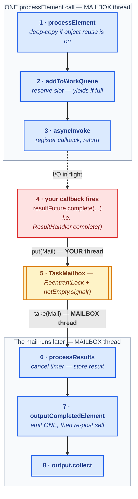
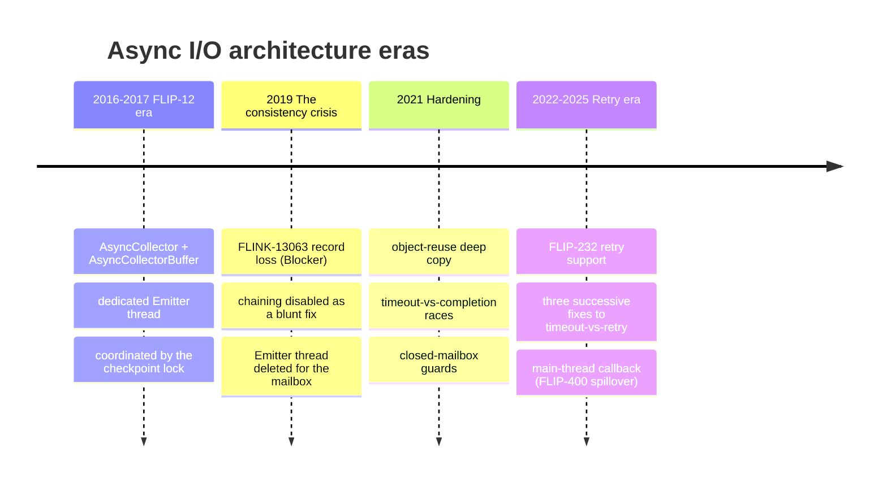
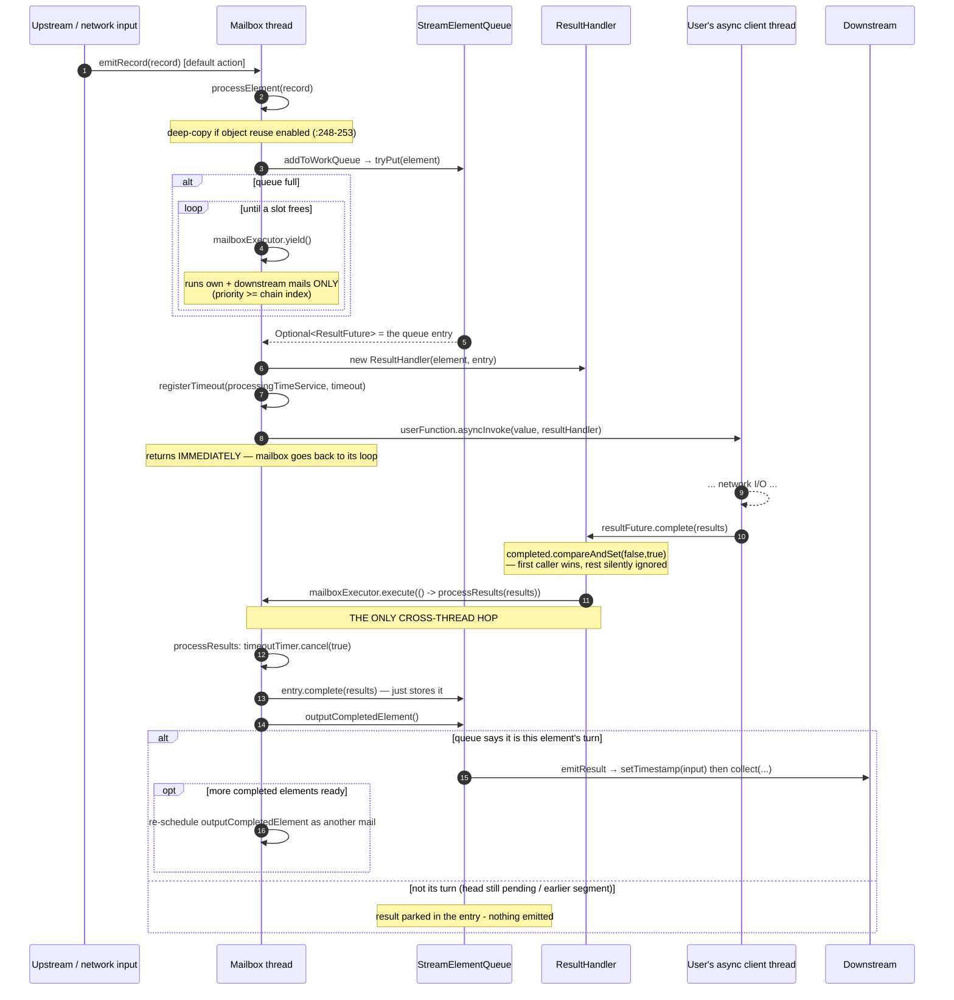
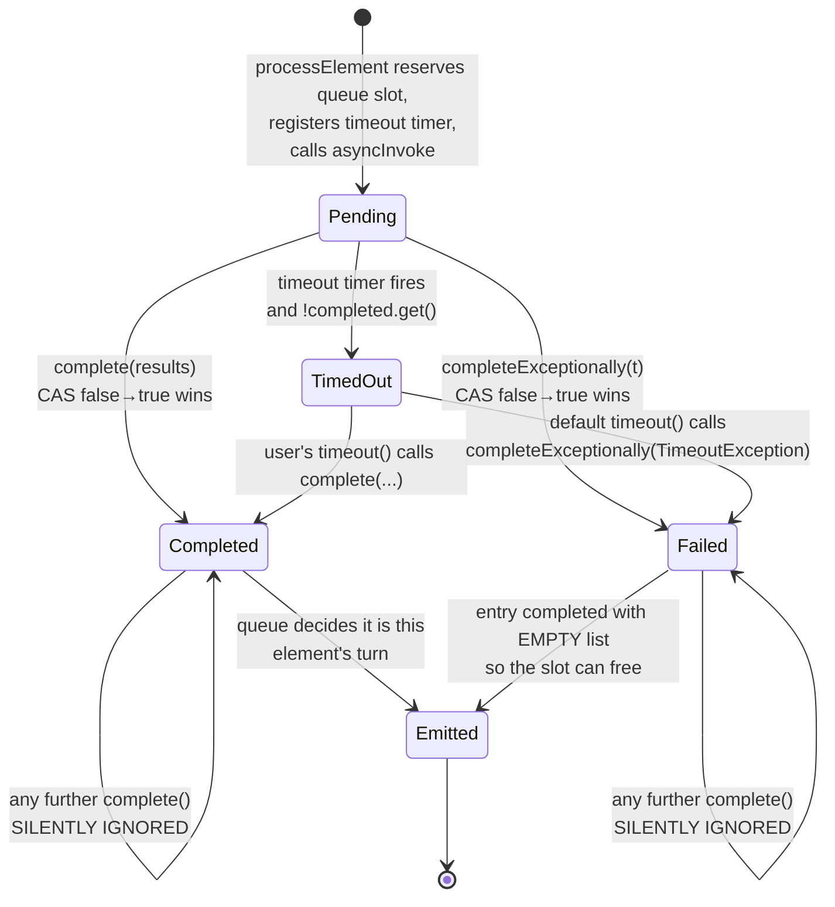
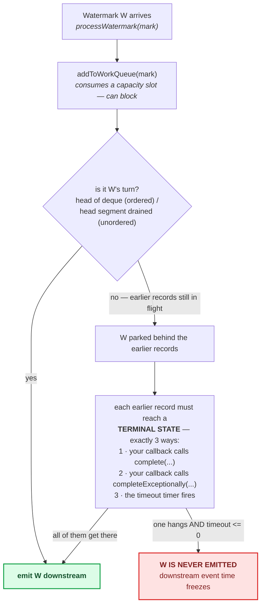
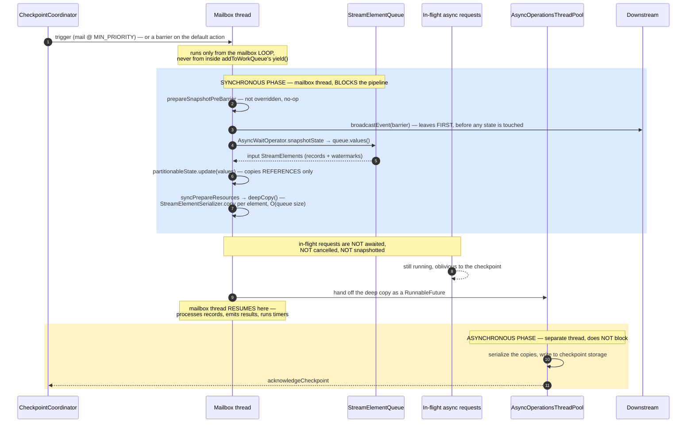
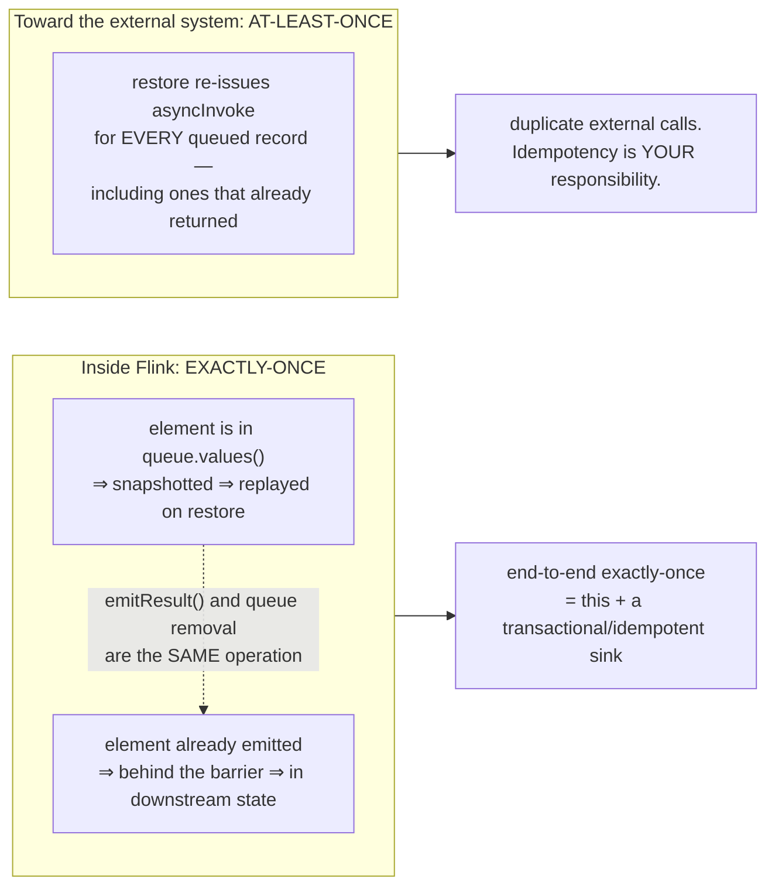
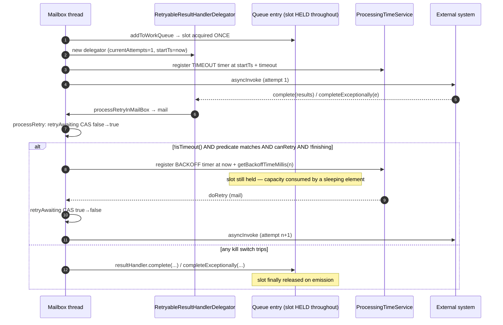
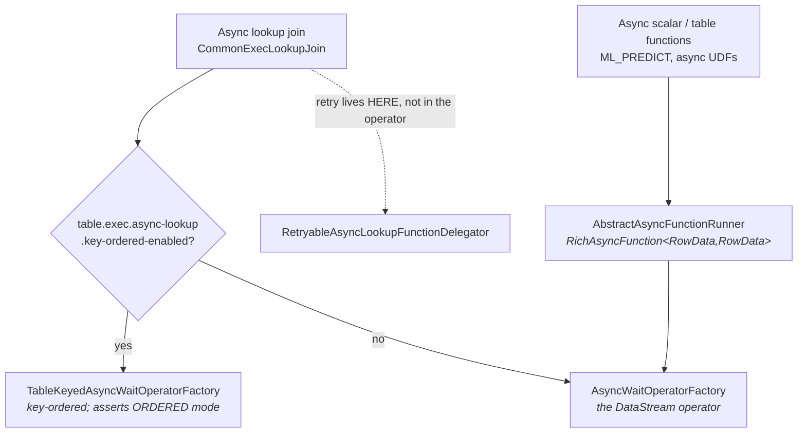

# Flink Async I/O Deep Dive — `AsyncWaitOperator`, Ordering, Watermarks, Checkpoints, Retries

Everything in this doc is read off the source tree of this fork (Apache Flink `2.3-SNAPSHOT`). Every non-obvious claim carries a `file:line` citation so you can verify it. Where the official documentation, the FLIP, or the folklore disagrees with the code, **the code wins and the disagreement is called out explicitly**.

The feature lives in three small packages:

| Path | Contents |
|---|---|
| `flink-streaming-java/.../api/functions/async/` | `AsyncFunction`, `ResultFuture`, `RichAsyncFunction`, `CollectionSupplier`, `AsyncRetryStrategy`, `AsyncRetryPredicate` |
| `flink-streaming-java/.../api/operators/async/` | `AsyncWaitOperator` (703 L — the whole engine), `AsyncWaitOperatorFactory` |
| `flink-streaming-java/.../api/operators/async/queue/` | `StreamElementQueue` + `Ordered` / `Unordered` implementations + entry types |
| `flink-streaming-java/.../api/datastream/AsyncDataStream.java` | The public entry points |
| `flink-streaming-java/.../util/retryable/` | `AsyncRetryStrategies`, `RetryPredicates` |

Official docs page in this tree: `docs/content/docs/dev/datastream/operators/asyncio.md`.

---

## Table of Contents

- [Part 0: The 60-second model](#part-0-the-60-second-model)
- [Part 1: Why the feature exists](#part-1-why-the-feature-exists)
- [Part 2: History — FLIP-12, FLIP-232, and the commits that reshaped it](#part-2-history--flip-12-flip-232-and-the-commits-that-reshaped-it)
- [Part 3: The API surface](#part-3-the-api-surface)
- [Part 4: Architecture and the threading model](#part-4-architecture-and-the-threading-model)
- [Part 5: The two queues — how ordering is actually enforced](#part-5-the-two-queues--how-ordering-is-actually-enforced)
- [Part 6: Watermarks](#part-6-watermarks)
- [Part 7: Checkpoints, barriers, and exactly-once](#part-7-checkpoints-barriers-and-exactly-once)
- [Part 8: Timeout and retry](#part-8-timeout-and-retry)
- [Part 9: Edge cases and failure modes](#part-9-edge-cases-and-failure-modes)
- [Part 10: Tuning](#part-10-tuning)
- [Part 11: How Table/SQL reuses this](#part-11-how-tablesql-reuses-this)
- [Appendix A: Class index](#appendix-a-class-index)
- [Appendix B: Myth-busting table](#appendix-b-myth-busting-table)

---

## Part 0: The 60-second model



🟦 **blue = the task mailbox thread** (single-threaded, owns *all* operator state and the queue)  🟥 **red = your async client's thread** (Flink creates none of these)  🟨 **yellow = the thread boundary itself** — the mailbox queue that one side `put`s to and the other `take`s from

The two blue lanes are the *same* thread at two different times: after step 3 the mailbox thread walks away and goes back to its loop, and steps 6-8 run later as a separate mail. The `StreamElementQueue` is touched at steps 2, 6 and 7 — it is capacity-bounded and holds **input elements plus a slot for each result**, never your client's pending request; see [Part 5](#part-5-the-two-queues--how-ordering-is-actually-enforced).

Five facts that everything else follows from:

1. **`asyncInvoke` runs on the mailbox thread**, inline from `processElement` (`AsyncWaitOperator.java:266/276`). Flink never spawns a thread for you. If `asyncInvoke` blocks, the entire task blocks.
2. **The queue holds input elements plus an empty slot for each result — it never holds your pending request.** The entry does implement `ResultFuture` (`StreamElementQueueEntry extends ResultFuture<OUT>`, `StreamElementQueueEntry.java:35`), but despite the name that is **not** a `java.util.concurrent.Future` — see §3.1. Flink has no handle on your in-flight call, which is why it cannot cancel one (§7.5).
3. **Every cross-thread hop goes through the mailbox.** There is not a single `synchronized` block or lock in `AsyncWaitOperator.java`. The checkpoint lock the original design used was deleted in FLINK-14857.
4. **Ordering is entirely delegated to the queue implementation.** The operator just asks "is anything ready?" and pops one.
5. **The checkpoint stores the input records and re-issues the requests on restore.** It does *not* wait for in-flight requests, and it does *not* store results.

---

## Part 1: Why the feature exists

The docs state the motivation plainly:

> "Naively accessing data in the external database, for example in a `MapFunction`, typically means **synchronous** interaction: A request is sent to the database and the `MapFunction` waits until the response has been received. In many cases, this waiting makes up the vast majority of the function's time."

The obvious alternative — crank up parallelism — is rejected on cost:

> "Improving throughput by just scaling the `MapFunction` to a very high parallelism is in some cases possible as well, but usually comes at a very high resource cost: Having many more parallel MapFunction instances means more tasks, threads, Flink-internal network connections, network connections to the database, buffers, and general internal bookkeeping overhead."

The arithmetic is the whole story. With a synchronous `MapFunction` and a 10 ms lookup, one subtask does **100 records/s**, and the only lever is parallelism — each unit of which costs a thread, a slot share, network connections and buffers. With async I/O and `capacity = 100`, one subtask has 100 requests in flight and does **~10,000 records/s** against the same latency, using one thread.

The prerequisite is real, though:

> "Implementing proper asynchronous I/O to a database (or key/value store) requires a client to that database that supports asynchronous requests. ... In the absence of such a client, one can try and turn a synchronous client into a limited concurrent client by creating multiple clients and handling the synchronous calls with a thread pool. However, this approach is usually less efficient than a proper asynchronous client."

---

## Part 2: History — FLIP-12, FLIP-232, and the commits that reshaped it

Reading the current code without the history is confusing, because **the architecture you see today is not the one FLIP-12 designed**. Two complete rewrites happened in between.

### 2.1 The four eras



### 2.2 FLIP-12 vs. what is actually in the tree

FLIP-12 ("Asynchronous I/O Design and Implementation", `cwiki.apache.org/confluence/pages/viewpage.action?pageId=65870673`) specified a dedicated **Emitter thread** that took results from a synchronized `AsyncCollectorBuffer` and pushed them downstream, mutually excluded against the task thread by the checkpoint lock.

| FLIP-12 as written | Current 2.x reality | Changed by |
|---|---|---|
| `AsyncCollector.collect(List)` / `collect(Throwable)` | `ResultFuture.complete(Collection)` / `completeExceptionally(Throwable)` | FLINK-5851, `40cec17f430` |
| `AsyncCollectorBuffer`, one class | `StreamElementQueue` SPI + `Ordered`/`Unordered` impls | FLINK-4391 polish, `ad603d59ec1` |
| **Dedicated Emitter thread** driving output | **No Emitter thread.** Results are posted as *mails*; emission runs on the task thread | **FLINK-14044**, `148ca3b6172` |
| `synchronized (checkpointLock)` between Emitter and Task | No lock anywhere; mailbox serialization replaces it | FLINK-14857, `4dfb9257284` |
| No retry concept | `AsyncRetryStrategy` + `RetryableResultHandlerDelegator` | FLIP-232 / FLINK-27878, `e85cf8c4cdf` |
| Blocking insert when buffer full | Insert loop **yields to the mailbox** | FLINK-12958 `14555ba5343` |

What *survived* FLIP-12 intact is the part that matters most for correctness: **state = the input `StreamElement`s** (§2.5 of the FLIP), and **"a watermark will be emitted if and only if after all AsyncCollectors coming before current watermark have been emitted"** (§2.4).

There is a nice historical irony in the original commit `f52830763d8`: the Emitter thread was removed and then *re-added* during review, with the rationale *"if there is no input coming, and we just use main thread to emit result, the finished async collectors may have to wait uncertained period of time to be emitted."* That is precisely the problem the mailbox later solved properly — mails wake the main thread — which is what let FLINK-14044 delete the thread for good three years later.

### 2.3 The commits worth knowing

| Date | Hash | JIRA | What it did |
|---|---|---|---|
| 2016-10-12 | `f52830763d8` | FLINK-4391 | Feature lands (fix version 1.2.0). |
| 2016-12-14 | `ad603d59ec1` | FLINK-4391 | Till Rohrmann's rework: `AsyncCollectorBuffer` → `StreamElementQueue` + Ordered/Unordered. |
| 2016-12-20 | `6c5a8711d80` | FLINK-4391 | Adds the `timeout` parameter. |
| 2017-01-25 | `a811545ecae` | FLINK-5638 | Deadlock closing two chained async operators. |
| 2017-02-03 | `215776b81a5` | FLINK-5652 | Memory leak: timeout `ScheduledFuture` pinned the queue entry. |
| 2017-10-30 | `6593e0f9e6d` | FLINK-7949 | **Recovery deadlock.** A snapshot can hold `capacity + 1` elements; fix starts the emitter *before* re-inserting so the queue can drain while refilling. |
| 2018-05-10 | `56df6904688` | FLINK-7789 | Adds the user-overridable `AsyncFunction#timeout` hook. |
| 2019-07-09 | `c773ce5ff1c` | **FLINK-13063** | **Blocker, record loss.** Releasing the checkpoint lock while waiting for queue space let upstream chained operators checkpoint mid-record. Blunt fix: `ChainingStrategy.HEAD` — chaining disabled entirely. |
| 2019-08-27 | `14555ba5343` | FLINK-12958 | Introduces `AsyncWaitOperatorFactory` + `MailboxExecutor`; wait loops now yield. |
| 2019-10-01 | `148ca3b6172` | **FLINK-14044** | **The rewrite.** −971 lines. Deletes `Emitter`, `OperatorActions`, `AsyncResult` &co. Introduces `ResultHandler` with its `AtomicBoolean completed` guard. |
| 2019-12-05 | `4dfb9257284` | FLINK-14857 | Deletes the last checkpoint-lock usage: *"every Mail action acquires checkpoint lock automatically."* |
| 2020-02-20 | `3a04e179e09` | FLINK-16219 | Restores chaining — except to legacy sources. Origin of today's documented caveat. |
| 2021-04-24 | `a4dcd91455d` | FLINK-12351 | Deep-copy `StreamElement` when object reuse is on. |
| 2021-05-05 | `56e292b92ec` | FLINK-22573 | A completed element could still get timed out; check the completed flag when the timer fires. |
| 2021-11-30 | `4065bfba917` | FLINK-24846 | Ignore completions arriving after the mailbox is closed. |
| 2022-04-29 | `e85cf8c4cdf` | **FLINK-27878** | FLIP-232 retry support. +1755 lines. |
| 2022-08-09 | `3a2fc5ef34f` | (hotfix) | Do the last retry attempt even if cancelling the timer failed. |
| 2023-01-31 | `0aab2cd369e` | FLINK-30477 | Timeout did not properly suppress a pending retry. |
| 2025-03-18 | `0b75ad105ba` | FLINK-37243 | Adds `complete(CollectionSupplier)` so conversion work runs on the mailbox thread (FLIP-400 spillover). |
| 2025-07-13 | `647b02f7dcc` | FLINK-38082 | `completeExceptionally` past the total-timeout budget could still schedule a retry. Fixed by wall-clock comparison against `startTs`. |

The through-line: **every major change moves work off ad-hoc threads and onto the mailbox thread**, and **every retry bug is a variant of "who wins between the timeout timer and the retry timer."**

---

## Part 3: The API surface

`AsyncDataStream` (`@PublicEvolving`, `AsyncDataStream.java:44`) exposes eight methods, all thin wrappers over one private builder:

| Method | Line | capacity | mode | retry |
|---|---|---|---|---|
| `unorderedWait(in, f, timeout, unit, capacity)` | 115 | explicit | UNORDERED | none |
| `unorderedWait(in, f, timeout, unit)` | 141 | **100** | UNORDERED | none |
| `orderedWait(in, f, timeout, unit, capacity)` | 165 | explicit | ORDERED | none |
| `orderedWait(in, f, timeout, unit)` | 192 | **100** | ORDERED | none |
| `unorderedWaitWithRetry(in, f, timeout, unit, strategy)` | 217 | **100** | UNORDERED | explicit |
| `unorderedWaitWithRetry(in, f, timeout, unit, capacity, strategy)` | 247 | explicit | UNORDERED | explicit |
| `orderedWaitWithRetry(in, f, timeout, unit, strategy)` | 277 | **100** | ORDERED | explicit |
| `orderedWaitWithRetry(in, f, timeout, unit, capacity, strategy)` | 307 | explicit | ORDERED | explicit |

`DEFAULT_QUEUE_CAPACITY = 100` is `private static final` (`AsyncDataStream.java:53`) — not configurable except by picking a capacity-taking overload.

```java
// AsyncDataStream.java:68-101 (abridged)
private static <IN, OUT> SingleOutputStreamOperator<OUT> addOperator(
        DataStream<IN> in, AsyncFunction<IN, OUT> func, long timeout,
        int bufSize, OutputMode mode, AsyncRetryStrategy<OUT> asyncRetryStrategy) {
    if (asyncRetryStrategy != NO_RETRY_STRATEGY) {
        Preconditions.checkArgument(
                timeout > 0, "Timeout should be configured when do async with retry.");
    }
    ...
    return in.transform("async wait operator", outTypeInfo, operatorFactory);
}
```

Three things to note:

- **Retry requires a timeout.** Genuinely enforced only in `AsyncDataStream.addOperator` via `Preconditions.checkArgument` (`AsyncDataStream.java:75-78`). The operator itself has just a bare Java `assert timeout > 0L` (`AsyncWaitOperator.java:263`), which is a **no-op unless the JVM runs with `-ea`** — so code that builds an `AsyncWaitOperatorFactory` directly, as the Table planner does, bypasses the check entirely (§9, row 15). Without retries, `timeout <= 0` is legal and means "no timeout timer" (`:272`).
- The operator's name in the web UI is the literal string `"async wait operator"`.
- Type extraction uses `new int[] {1, 0}` — `OUT` is recovered from `asyncInvoke`'s second parameter `ResultFuture<OUT>`. This is why a lambda or raw `AsyncFunction` often needs an explicit `.returns(...)`.

**`OutputMode` is a pure queue-selection decision.** It flows factory → operator field → a single `switch` in `setup`, and *nothing else in the operator branches on it*:

```java
// AsyncWaitOperator.java:189-198
switch (outputMode) {
    case ORDERED:   queue = new OrderedStreamElementQueue<>(capacity);   break;
    case UNORDERED: queue = new UnorderedStreamElementQueue<>(capacity); break;
    default: throw new IllegalStateException("Unknown async mode: " + outputMode + '.');
}
```

### 3.1 The user contract

```java
public interface AsyncFunction<IN, OUT> extends Function, Serializable {
    void asyncInvoke(IN input, ResultFuture<OUT> resultFuture) throws Exception;

    default void timeout(IN input, ResultFuture<OUT> resultFuture) throws Exception {
        resultFuture.completeExceptionally(
                new TimeoutException("Async function call has timed out."));
    }
}
```

That default `timeout` implementation (`AsyncFunction.java:96-99`) is the single most consequential default in the feature: **unless you override it, any timeout kills the job.**

**`ResultFuture` is not a `java.util.concurrent.Future`.** The name misleads. It is a *write-only completion sink* — three methods, no read side at all:

```java
// ResultFuture.java:31-58
@PublicEvolving
public interface ResultFuture<OUT> {
    void complete(Collection<OUT> result);
    void completeExceptionally(Throwable error);
    void complete(CollectionSupplier<OUT> supplier);   // FLINK-37243
}
```

No `get()`, no `join()`, no `cancel()`, not even `isDone()`. You call it; nobody awaits it.

`ResultFuture` is implemented at **two different layers**, by different objects, and your code only ever sees the outer one:

```
ResultFuture<OUT>                              (interface — write-only, 3 methods)
│
├── ResultHandler                              AsyncWaitOperator.java:594   ← HANDED TO YOUR asyncInvoke
│      adds: the `completed` CAS, the timeout timer, the hop onto the mailbox thread
│
├── RetryableResultHandlerDelegator            AsyncWaitOperator.java:435   ← handed to you instead, when retry is on
│      wraps a ResultHandler; adds currentAttempts, startTs, the backoff timer
│
└── StreamElementQueueEntry<OUT>               StreamElementQueueEntry.java:35   (still an INTERFACE)
       adds the READ side the operator needs: isDone(), emitResult(...), getInputElement()
       │
       ├── StreamRecordQueueEntry              StreamRecordQueueEntry.java:40      ← used by ORDERED queue
       │   └── SegmentedStreamRecordQueueEntry UnorderedStreamElementQueue.java:188 ← used by UNORDERED queue
       │          overrides complete() to also call segment.completed(this)
       └── WatermarkQueueEntry                 WatermarkQueueEntry.java:32         ← both queues, for watermarks
```

Which concrete entry is built depends on the mode — that is the *only* place the two queues differ in entry type:

| Element | Ordered queue | Unordered queue |
|---|---|---|
| record | `new StreamRecordQueueEntry<>(...)` (`OrderedStreamElementQueue.java:121`) | `new SegmentedStreamRecordQueueEntry<>(record, lastSegment)` (`UnorderedStreamElementQueue.java:118`) |
| watermark | `new WatermarkQueueEntry<>(...)` (`:124`) | `new WatermarkQueueEntry<>(...)` (`:140`) |

`SegmentedStreamRecordQueueEntry` is the hook that makes unordered mode work: its `complete()` override notifies the owning segment so the entry migrates from `incompleteElements` to `completedElements` (§5.2).

The entry interface also *narrows* what it inherits: `completeExceptionally` and `complete(CollectionSupplier)` both throw `UnsupportedOperationException` on the entry (`StreamElementQueueEntry.java:60-69`, *"Exceptions must be handled in the AsyncWaitOperator"*). That is precisely why your code is never handed an entry — the `ResultHandler` wrapper is what makes exceptions and timeouts expressible at all (§4.4).

> Not on this list, despite the name: `DelegatingAsyncResultFuture` and `DelegatingAsyncTableResultFuture` in the Table runtime implement **`BiConsumer`**, not `ResultFuture` — they *hold* a `ResultFuture` and adapt a `CompletableFuture` callback onto it.

The practical consequence of all this: **Flink cannot await, poll, or cancel your in-flight request.** An entry completes only because your callback called one of the three methods above, or because the timeout timer fired.

Where the user's collection-building code runs:

| Method | Thread |
|---|---|
| `complete(Collection<OUT>)` | caller's thread; the collection is handed to the mailbox |
| `completeExceptionally(Throwable)` | caller's thread; fails the task via `failExternally` |
| `complete(CollectionSupplier<OUT>)` (FLINK-37243) | **the mailbox thread** — the supplier is invoked inside the mail |

> "The `ResultFuture` is completed with the first call of `ResultFuture.complete` in the Java API. All subsequent `complete` calls will be ignored."

That is enforced by an `AtomicBoolean` CAS, covered in §4.4.

---

## Part 4: Architecture and the threading model

### 4.1 Who runs what

| Callback | Thread |
|---|---|
| `processElement(StreamRecord)` | task mailbox thread |
| `AsyncFunction.asyncInvoke(...)` | **also the mailbox thread** — a plain synchronous call |
| the I/O + the callback that calls `ResultFuture.complete(...)` | whatever thread the user's client uses; **Flink creates none of these** |
| `processResults` / `outputCompletedElement()` | mailbox thread (arrives as a mail) |
| `AsyncFunction.timeout(...)` | mailbox thread (processing-time timers are deferred into the mailbox) |

The `asyncInvoke`-on-the-mailbox-thread fact is the one users get wrong most often. Here is `processElement` with the retry branch elided:

```java
// AsyncWaitOperator.java:245-278 (abridged)
public void processElement(StreamRecord<IN> record) throws Exception {
    StreamRecord<IN> element;
    // copy the element avoid the element is reused
    if (isObjectReuseEnabled) {
        element = (StreamRecord<IN>) inStreamElementSerializer.copy(record);
    } else {
        element = record;
    }

    // add element first to the queue
    final ResultFuture<OUT> entry = addToWorkQueue(element);
    ...
    final ResultHandler resultHandler = new ResultHandler(element, entry);

    // register a timeout for the entry if timeout is configured
    if (timeout > 0L) {
        resultHandler.registerTimeout(getProcessingTimeService(), timeout);
    }

    userFunction.asyncInvoke(element.getValue(), resultHandler);
}
```

Note the ordering: **the queue slot is reserved (line 256) before `asyncInvoke` is called (line 276)**. Capacity is applied on entry, not on completion.

#### An annotated `asyncInvoke` — who runs each line

```java
@Override
public void asyncInvoke(String key, ResultFuture<Tuple2<String, String>> resultFuture) {
    // ── MAILBOX THREAD: processElement called us inline ──
    CompletableFuture<String> f = client.query(key);   // returns immediately, I/O is elsewhere

    f.thenAccept(dbResult -> {
        // ── YOUR CLIENT'S THREAD: whichever thread completes `f` ──
        resultFuture.complete(Collections.singleton(Tuple2.of(key, dbResult)));
        //  └─ this IS ResultHandler.complete(...)
    });

    // ── MAILBOX THREAD: we return here immediately; the mailbox goes back to its loop ──
}
```

| Step | Thread | Why |
|---|---|---|
| body of `asyncInvoke` | **mailbox** | called inline from `processElement` (`:276`) |
| `client.query(key)` | **mailbox** issues the call; the I/O itself runs on your client's threads | Flink is not involved |
| the `thenAccept` lambda | **the thread that completes the `CompletableFuture`** — a Netty event loop, `ForkJoinPool.commonPool`, your own executor… Flink never chooses it | it's your client's business |
| `ResultHandler.complete(...)` | **your callback thread** | that is why `completed` is an `AtomicBoolean` and not a plain field |
| `mailboxExecutor.execute(...)` | **your callback thread** — the *producer* side of the hop | `MailboxExecutor` javadoc: *"All submission functions can be called from any thread"* |
| the lambda passed to `execute`, i.e. `processResults(results)` | **mailbox thread** — the *consumer* side | runs when the mailbox loop (or a `yield()`) dequeues the mail |

#### The hop itself is a lock-and-condition handoff

There is no magic here. `mailboxExecutor.execute(...)` just wraps your work in a `Mail` and appends it to a lock-guarded deque:

```java
// MailboxExecutorImpl.java:69-87 — PRODUCER side, callable from ANY thread
@Override
public void execute(MailOptions mailOptions, ThrowingRunnable<? extends Exception> command,
        String descriptionFormat, Object... descriptionArgs) {
    try {
        mailbox.put(new Mail(mailOptions, command, priority, actionExecutor,
                             descriptionFormat, descriptionArgs));
    } catch (MailboxClosedException mbex) {
        throw new RejectedExecutionException(mbex);
    }
}
```

```java
// TaskMailboxImpl.java:293-305 — the actual handoff
private void putLast(@Nonnull Mail mail) {
    final ReentrantLock lock = this.lock;
    lock.lock();
    try {
        checkPutStateConditions();
        queue.addLast(mail);
        hasNewMail = true;
        notEmpty.signal();          // ← wakes the mailbox thread if it is parked
    } finally {
        lock.unlock();
    }
}
```

```java
// TaskMailboxImpl.java:145-168 — CONSUMER side, single-threadedness ENFORCED
public @Nonnull Mail take(int priority) throws InterruptedException {
    checkIsMailboxThread();         // ← hard assertion: only the task thread may consume
    ...
    while ((headMail = takeOrNull(queue, priority)) == null) {
        notEmpty.await(1, TimeUnit.SECONDS);
    }
    return headMail;
}
```

So: **your thread does the `put` and walks away; the mailbox thread does the `take` and runs the lambda.** The `Mail` object is the only thing that crosses. That is the entire "cross-thread hop" — a textbook producer/consumer queue, with `checkIsMailboxThread()` making the consumer side single-threaded by assertion rather than by convention.

Two subtleties worth knowing:

1. **If the future is already complete, your "callback thread" *is* the mailbox thread.** `CompletableFuture.thenAccept` on an already-completed future runs inline on the calling thread — and inside `asyncInvoke` that is the mailbox thread. A cache hit therefore does `complete` → `execute` → `put` all on the mailbox thread, and the same thread picks the mail up moments later. Everything still works, but *"the callback always arrives on a different thread"* is not something you can rely on. (This is `CompletableFuture` semantics, not Flink code.)
2. **`complete(CollectionSupplier)` deliberately inverts the split** — the supplier body is executed *inside* the mail, on the mailbox thread. That is the entire point of the overload (FLINK-37243); see §3.1.

What is the mailbox thread doing between steps 3 and 6? Going back to its loop: pulling the next record from the network, running other operators' mails, taking checkpoints. **That gap is where the concurrency comes from** — not from Flink running your function in parallel.

### 4.2 The lifecycle of one record



### 4.3 Why the mailbox replaced the checkpoint lock — and why `yield()` is subtle

`MailboxExecutor` is an `Executor`-like façade over the `StreamTask`'s single-threaded mail queue. Its javadoc states the failure mode that motivated `yield()`:

> "One operator cannot fully process an input record and blocks the task thread until some resources are available. However, since the introduction of the mailbox model blocking the task thread will not only block new inputs but also all events from being processed. If the resources depend on downstream operators being able to process such events (e.g., timers), then we may easily arrive at some livelocks." — `MailboxExecutor.java:40-50`

The blocking loop is three lines:

```java
// AsyncWaitOperator.java:346-355
private ResultFuture<OUT> addToWorkQueue(StreamElement streamElement)
        throws InterruptedException {
    Optional<ResultFuture<OUT>> queueEntry;
    while (!(queueEntry = queue.tryPut(streamElement)).isPresent()) {
        mailboxExecutor.yield();
    }
    return queueEntry.get();
}
```

**`yield()` is not "run any pending work".** It takes exactly one mail whose priority is `>= this executor's priority` and runs it (`MailboxExecutorImpl.java:89-97`), and the filter is `mail.getPriority() >= priority` (`TaskMailboxImpl.java:344`). The operator's priority is its **chain index** (`StreamOperatorFactoryUtil.java:56-59`), and chain index increases downstream (`StreamingJobGraphGenerator.java:974`). Therefore, while blocked:

| Mail source | Runs during `yield()`? |
|---|---|
| This operator's own completion mails | ✅ yes — this is what frees the slot |
| This operator's timeout / retry timer mails | ✅ yes (`StreamTask.java:1876-1885`) |
| Downstream chained operators' mails | ✅ yes (higher chain index) |
| **Upstream** chained operators' mails | ❌ no (lower chain index) |
| **Checkpoint trigger mails** (`mainMailboxExecutor`, `MIN_PRIORITY = -1`) | ❌ **no** |
| The mailbox loop's **default action** (reading the next network record) | ❌ no — it isn't a mail at all |

That table is the whole design. Refusing upstream mails is what prevents the reverse dependency (upstream pushing more input into an already-full queue) from re-entering and deadlocking. Accepting own+downstream mails is what guarantees forward progress.

**Consequence worth internalizing:** an async operator sitting on a full queue **delays checkpoint triggering for its whole task** until at least one slot frees. Backpressure and checkpoint delay are the same mechanism here; you cannot have the first without risking the second. The timeout timer is the only escape hatch from a permanently stuck queue — which is exactly why `endInput()` carries this comment:

```java
// AsyncWaitOperator.java:322-331
@Override
public void endInput() throws Exception {
    // we should finish all in fight delayed retry immediately.
    finishInFlightDelayedRetry();

    // we should wait here for the data in flight to be finished. the reason is that the
    // timer not in running will be forbidden to fire after this, so that when the async
    // operation is stuck, it results in deadlock due to what the timeout timer is not fired
    waitInFlightInputsFinished();
}
```

### 4.4 The `ResultHandler` state machine

`ResultHandler` (`AsyncWaitOperator.java:593-702`) is the thread-crossing wrapper. Its fields:

| Field | Line | Semantics |
|---|---|---|
| `ScheduledFuture<?> timeoutTimer` | 596 | Set by `registerTimeout`, or written *by the delegator* in retry mode (`:463`). `null` when `timeout <= 0`. |
| `final StreamRecord<IN> inputRecord` | 599 | The (possibly copied) input. Javadoc says "used only to report errors" but it is also read to re-invoke on retry and timeout. |
| `final ResultFuture<OUT> resultFuture` | 605 | The **queue entry** handle. |
| `final AtomicBoolean completed` | 612 | The single idempotency gate. |



The two completion methods, verbatim:

```java
// AsyncWaitOperator.java:619-630
@Override
public void complete(Collection<OUT> results) {
    // already completed (exceptionally or with previous complete call from ill-written
    // AsyncFunction), so ignore additional result
    if (!completed.compareAndSet(false, true)) {
        return;
    }
    processInMailbox(results);
}
```

```java
// AsyncWaitOperator.java:672-691
@Override
public void completeExceptionally(Throwable error) {
    // already completed, so ignore exception
    if (!completed.compareAndSet(false, true)) {
        return;
    }

    // signal failure through task
    getContainingTask().getEnvironment()
            .failExternally(new Exception(
                    "Could not complete the stream element: " + inputRecord + '.', error));

    // complete with empty result, so that we remove timer and move ahead processing (to
    // leave potentially blocking section in #addToWorkQueue or #waitInFlightInputsFinished)
    processInMailbox(Collections.emptyList());
}
```

Two behaviors worth reading twice:

- **Duplicate completions are silent no-ops.** No exception, no log line. The `ResultFuture` javadoc pushes the warning onto the user instead: *"Note that it should be called for exactly one time in the user code. Calling this function for multiple times will cause data lose."* (`ResultFuture.java:33-36`). The same CAS makes a result and a timeout racing each other safe — whichever lands first wins.
- **`completeExceptionally` fails the task *and then* completes the entry with an empty list.** This is deliberate (the comment says so): without it the slot would never free and a mailbox thread parked in `addToWorkQueue` would never observe the failure. So the semantics are "exception ⇒ this record produces zero outputs and the job dies", **not** "exception ⇒ record retried" — unless a retry strategy is configured.

---

## Part 5: The two queues — how ordering is actually enforced

The operator adds no ordering of its own. `outputCompletedElement()` just asks the queue whether anything is ready and pops exactly one:

```java
// AsyncWaitOperator.java:391-411
private void outputCompletedElement() {
    if (queue.hasCompletedElements()) {
        // emit only one element to not block the mailbox thread unnecessarily
        queue.emitCompletedElement(timestampedCollector);
        // if there are more completed elements, emit them with subsequent mails
        if (queue.hasCompletedElements()) {
            try {
                mailboxExecutor.execute(
                        this::outputCompletedElement, "AsyncWaitOperator#outputCompletedElement");
            } catch (RejectedExecutionException mailboxClosedException) {
                // This exception can only happen if the operator is cancelled which means all
                // pending records can be safely ignored since they will be processed one more
                // time after recovery.
                LOG.debug("Attempt to complete element is ignored since the mailbox rejected the execution.",
                        mailboxClosedException);
            }
        }
    }
}
```

**One element per mail, then re-schedule itself.** That yields the mailbox between emissions so timers, downstream mails and checkpoint work interleave instead of being starved by a large completed backlog. And because the self-rescheduling mail carries this operator's own priority, it is runnable from inside a blocked `addToWorkQueue` — which is precisely how a full queue drains.

### 5.1 `OrderedStreamElementQueue` — a FIFO and nothing else

```java
// OrderedStreamElementQueue.java:62-73
@Override
public boolean hasCompletedElements() {
    return !queue.isEmpty() && queue.peek().isDone();
}

@Override
public void emitCompletedElement(TimestampedCollector<OUT> output) {
    if (hasCompletedElements()) {
        final StreamElementQueueEntry<OUT> head = queue.poll();
        head.emitResult(output);
    }
}
```

An `ArrayDeque`. That is the entire implementation. The contract is *output order == input order* (`OrderedStreamElementQueue.java:38-43`), and the only way to enforce that with a FIFO is to gate emission on `peek()`.

**Head-of-line blocking is not a side effect, it is the mechanism.** If the head is still pending and entries 2..N have all completed, `hasCompletedElements()` returns `false` and *nothing at all* is emitted. The costs:

- **Latency:** the emission latency of element *i* is `max(latency of 1..i)`, not `latency of i`.
- **Heap:** up to `capacity` input records **plus** up to `capacity` result collections are pinned. One input may fan out to an unbounded number of outputs, so worst case is `capacity × (record + result collection)`.
- **Throughput:** once full, the operator stops reading input entirely. A single stuck head throttles the whole pipeline after `capacity` more records.

### 5.2 `UnorderedStreamElementQueue` — watermark-delimited segments

This is the subtle one. Note: **there are no `firstSet`/`lastSet` fields in 2.x** — that was the Flink 1.x design. Today it is a deque of `Segment`s:

```java
// UnorderedStreamElementQueue.java:58-73 (abridged)
private final int capacity;
/** Queue of queue entries segmented by watermarks. */
private final Deque<Segment<OUT>> segments;
private int numberOfEntries;
```

```java
// UnorderedStreamElementQueue.java:209-219
static class Segment<OUT> {
    /** Unfinished input elements. */
    private final Set<StreamElementQueueEntry<OUT>> incompleteElements;   // HashSet — order irrelevant
    /** Undrained finished elements. */
    private final Queue<StreamElementQueueEntry<OUT>> completedElements;  // ArrayDeque — completion order
```

The class javadoc states the guarantee:

> "Elements can be logically grouped into different segments separated by watermarks. A segment needs to be completely emitted before entries from a following segment are emitted. Thus, no stream record can be overtaken by a watermark and no watermark can overtake a stream record. However, stream records falling in the same segment between two watermarks can overtake each other." — `UnorderedStreamElementQueue.java:42-52`

A watermark does two things atomically:

```java
// UnorderedStreamElementQueue.java:129-146
private StreamElementQueueEntry<OUT> addWatermark(Watermark watermark) {
    Segment<OUT> watermarkSegment;
    if (!segments.isEmpty() && segments.getLast().isEmpty()) {
        // reuse already existing segment if possible (completely drained) or the new segment
        // added at the end of this method for two succeeding watermarks
        watermarkSegment = segments.getLast();
    } else {
        watermarkSegment = addSegment(1);
    }

    StreamElementQueueEntry<OUT> watermarkEntry = new WatermarkQueueEntry<>(watermark);
    watermarkSegment.add(watermarkEntry);

    // add a new segment for actual elements
    addSegment(capacity);
    return watermarkEntry;
}
```

1. the watermark lands in a segment containing **nothing else**;
2. a **fresh empty segment** is appended, so every subsequent record goes strictly after it.

And emission only ever looks at the head segment:

```java
// UnorderedStreamElementQueue.java:148-166
@Override
public boolean hasCompletedElements() {
    return !this.segments.isEmpty() && this.segments.getFirst().hasCompleted();
}

@Override
public void emitCompletedElement(TimestampedCollector<OUT> output) {
    if (segments.isEmpty()) {
        return;
    }
    final Segment currentSegment = segments.getFirst();
    numberOfEntries -= currentSegment.emitCompleted(output);

    // remove any segment if there are further segments, if not leave it as an optimization even
    // if empty
    if (segments.size() > 1 && currentSegment.isEmpty()) {
        segments.pop();
    }
}
```

#### Worked example: A, B, W1, C, D — with B completing after C

```
after all five tryPut calls:

  segments:  [ S1                ] [ S2      ] [ S3               ]
             [ incomplete: A, B  ] [ comp: W1] [ incomplete: C, D ]
                    ^head                            ^last
  numberOfEntries = 5   (the watermark counts against capacity too)
```

| Event | Queue effect | Emitted |
|---|---|---|
| **C completes** | `S3{comp:[C], inc:{D}}` | **nothing** — head is S1, whose completed queue is empty |
| **B completes** | `S1{comp:[B], inc:{A}}` | **B** — *before A*. Intra-segment overtaking, as advertised |
| **A completes** | S1 emptied → `segments.pop()` | **A**; head becomes S2 |
| next mail | S2 has W1 done → emit, S2 popped | **W1** |
| next mail | head S3 has C completed | **C** |
| D completes | | **D** |

Emitted order: `B, A, W1, C, D`. **Only A and B can precede W1** — C and D cannot, no matter how fast they complete. This is asserted verbatim in `UnorderedStreamElementQueueTest.testCompletionOrder` (*"this should not make any item completed, because R3 is behind W1"*).

#### Proof that a pre-watermark record can never be emitted after that watermark

**I1 (placement).** `addWatermark` puts W either in a brand-new capacity-1 segment (`:137`) or in `segments.getLast()` **only when that segment is verified empty** (`:131-135`) — meaning everything it held was already emitted. It then unconditionally appends a fresh segment (`:144`). Records only ever go into `segments.getLast()` (`addRecord`, `:113`). So for a watermark at deque index *i*, every record enqueued before W is in a segment with index `< i`, and every record after W is in a segment with index `> i`.

**I2 (drain order).** `emitCompletedElement` reads and drains **only `segments.getFirst()`** (`:158-159`) and pops the head only when it is fully empty (`:163-165`). So segments are emitted strictly in deque order and exhaustively.

I1 + I2 ⇒ every record that arrived before W is emitted before W. ∎

#### Gotchas in this class

- `isEmpty()` is `numberOfEntries == 0` (`:178-180`), **not** `segments.isEmpty()`. `emitCompletedElement` deliberately keeps one drained segment around as an allocation optimization, so the deque is never emptied once created. `waitInFlightInputsFinished` depends on `isEmpty()` (`AsyncWaitOperator.java:379`), so the distinction matters for termination.
- **Watermarks consume queue capacity.** `numberOfEntries` counts them and capacity is checked against it (`:77, 87`). Same in the ordered queue (`:96, 99`).
- The `Segment.completed` double-complete guard:

```java
// UnorderedStreamElementQueue.java:221-230
void completed(StreamElementQueueEntry<OUT> elementQueueEntry) {
    // adding only to completed queue if not completed before
    // there may be a real result coming after a timeout result, which is updated in the
    // queue entry but the entry is not re-added to the complete queue
    if (incompleteElements.remove(elementQueueEntry)) {
        completedElements.add(elementQueueEntry);
    }
}
```

  A late real result arriving after a timeout result mutates the entry but does **not** enqueue it twice.

---

## Part 6: Watermarks

### 6.1 The path and why the watermark is queued at all

```java
// AsyncWaitOperator.java:280-288
@Override
public void processWatermark(Watermark mark) throws Exception {
    addToWorkQueue(mark);

    // watermarks are always completed
    // if there is no prior element, we can directly emit them
    // this also avoids watermarks being held back until the next element has been processed
    outputCompletedElement();
}
```

**An assumption worth making explicit before any of this matters:** everything in Part 6 applies only if watermarks actually *flow through* the async operator — i.e. the `WatermarkStrategy` is assigned **upstream** of it. `source.assignTimestampsAndWatermarks(...)` then `AsyncDataStream.unorderedWait(...)` fences as described here; assigning watermarks *after* the async operator means it never sees one, every record lands in a single unbounded segment, and unordered mode is genuinely unordered (with none of the §6.5 cost — and none of the ordering guarantee either, since the timestamps being watermarked downstream are the ones the async results carry out).

A watermark is a promise to downstream: *no element with timestamp ≤ W will follow*. At the moment W reaches the async operator, the operator is still holding up to `capacity` records that arrived **before** W and therefore may carry timestamps ≤ W. Forwarding W immediately would make every one of those records **late** downstream — dropped by windows, ignored by event-time joins. So W is parked in the same structure as the records and released when its turn comes.

The `outputCompletedElement()` call right after the `tryPut` is an optimization: `WatermarkQueueEntry.isDone()` is hard-coded `true` (`WatermarkQueueEntry.java:51-53`), so a watermark arriving into an empty queue is emitted on the spot rather than waiting for the next completion mail.

> **Contrast with the checkpoint barrier, which is *not* queued.** A barrier is not a `StreamElement` and never reaches the operator as an element — it overtakes everything in flight, and consistency is recovered by snapshotting the queue instead of by ordering. See §7.2, "Why the barrier is not queued the way a watermark is."

| | `StreamRecordQueueEntry` | `WatermarkQueueEntry` |
|---|---|---|
| `isDone()` | `completedElements != null` (`:50-52`) | **always `true`** (`:51-53`) |
| `complete(Collection)` | stores the result (`:69-71`) | throws `IllegalStateException("Cannot complete a watermark.")` (`:56-58`) |
| `emitResult` | `output.setTimestamp(inputRecord)` then collect each (`:61-66`) | `output.emitWatermark(watermark)` (`:40-42`) |

### 6.2 The guarantee is about arrival order, not timestamps

> record R is emitted **before** watermark W ⟺ R was `processElement`-ed **before** W was `processWatermark`-ed.

The queues never inspect `StreamRecord.getTimestamp()` for ordering. The only timestamp use is at emission:

```java
// StreamRecordQueueEntry.java:60-66
@Override
public void emitResult(TimestampedCollector<OUT> output) {
    output.setTimestamp(inputRecord);
    for (OUT r : completedElements) {
        output.collect(r);
    }
}
```

The **input record's** timestamp is copied onto every output record (and erased if the input had none). So the async function cannot change an element's event time, and no timestamp is invented. One input producing N outputs gives all N the same timestamp.

### 6.3 Does async I/O create late data downstream?

**For the classic `Watermark` path: no.** The operator preserves the record↔watermark arrival partition exactly and preserves timestamps exactly. If a record was not late entering the operator, it is not late leaving it. This holds in **both** modes — unordered only reshuffles records *within* one inter-watermark segment, and all such records share the same "which watermarks have I already passed" status.

**But there are three real escape hatches, and the first one matters in production:**

1. **`WatermarkStatus` (idleness) is not queued — it bypasses the queue entirely.** `AsyncWaitOperator` does not override `processWatermarkStatus`, so the base implementation forwards immediately:

   ```java
   // AbstractStreamOperator.java:719-721
   public void processWatermarkStatus(WatermarkStatus watermarkStatus) throws Exception {
       output.emitWatermarkStatus(watermarkStatus);
   }
   ```

   An `IDLE` marker produced by `WatermarkStrategy.withIdleness(...)` upstream therefore **jumps ahead of every in-flight record**. Downstream, `StatusWatermarkValve` stops counting this channel in the min-watermark computation (`StatusWatermarkValve.java:214-223`), letting the downstream watermark advance from *other* channels past the timestamps of records still sitting in the async queue. Those records then arrive **late**. *(The code path is unambiguous — no override, immediate forward — but no test in this tree exercises it, so treat the end-to-end consequence as a strong inference rather than a pinned behavior.)*

2. **Generalized 2.x watermarks (`WatermarkEvent`) also bypass the queue.** They travel as a separate `AbstractEvent`, not a `StreamElement`, and `AsyncWaitOperator` does not override the overload, so `AbstractStreamOperator.java:775-778` forwards them immediately. **Only the legacy `org.apache.flink.streaming.api.watermark.Watermark` is fenced by the queue.**

3. **`LatencyMarker` bypasses too** — harmless for correctness, but it means async-I/O latency is under-reported by latency markers. Amusing detail: the `element.isLatencyMarker()` branch in `open()` (`AsyncWaitOperator.java:231-232`) is **dead code**, since both `tryPut` implementations reject anything that is not a record or a watermark.

### 6.4 Liveness — what actually keeps the watermark moving

Watermark correctness here is **two independent properties**, and only one of them is enforced by the queue:

| Property | Meaning | Enforced by |
|---|---|---|
| **Safety** | a watermark never overtakes a record that arrived before it | the queue structure (§6.1-6.2) — always holds |
| **Liveness** | the watermark eventually *does* get emitted | **nothing in the queue** — it depends entirely on the elements in front of it completing |

In both modes the release condition is the same:

> **watermark W is emitted ⟺ every record that arrived before W has reached a terminal state and been emitted.**

- ORDERED: W must reach the head of the deque, so everything enqueued before it must have been polled off.
- UNORDERED: W's segment must become the head segment, which requires the preceding segment to be fully drained (`emitCompletedElement`, `UnorderedStreamElementQueue.java:158-165`).

And a queue entry reaches a terminal state in **exactly three ways**:

1. your callback calls `complete(...)` — the result is emitted;
2. your callback calls `completeExceptionally(...)` — the job fails, and the entry is completed with an empty list precisely so the queue can still drain (`AsyncWaitOperator.java:686-690`);
3. the **timeout timer** fires and `AsyncFunction#timeout` completes it.

There is no fourth way. The operator cannot cancel, poll, or otherwise time-bound your request (§3.1). Which gives the operationally important consequence:



**A single hung request with no timeout freezes event time for everything downstream.** Windows stop firing, event-time timers stop firing, event-time joins stall. And it is worse than "this subtask stalls": the downstream `StatusWatermarkValve` takes the **minimum** across its input channels, so one stuck subtask holds the watermark back for every downstream subtask it feeds. This is the concrete reason the doc keeps saying *set a timeout* — the timeout is not only about failing fast on a dead backend, it is the **only liveness guarantee the watermark has**.

#### A worked example — safety and liveness in one timeline

Job: enrich a clickstream with a profile lookup, then a 1-minute event-time tumbling window. **UNORDERED** mode, `capacity = 5`, `timeout = 10s`. Wall clock is processing time; the timestamps in the records are event time. (Capacity must be at least 5 here: the watermark occupies a slot too, so the five elements below exactly fill the queue.)

Arrivals:

| wall clock | arrives | event time | queue after |
|---|---|---|---|
| 0 ms | record **A** | 10:00:01 | `[S1{A}]` |
| 1 ms | record **B** | 10:00:03 | `[S1{A,B}]` |
| 2 ms | **W(10:00:05)** | — | `[S1{A,B}] [S2{W}] [S3{}]` |
| 3 ms | record **C** | 10:00:07 | `… [S3{C}]` |
| 4 ms | record **D** | 10:00:09 | `… [S3{C,D}]` |

Completions:

| wall clock | event | emitted? |
|---|---|---|
| 20 ms | C returns | **no** — head segment is S1; C sits in `S3.completedElements` |
| 25 ms | D returns | **no** — same reason |
| 30 ms | B returns | **yes → emit B** (event time 10:00:03) |

Note what just happened: **B was emitted before A**, even though A arrived first *and* has an earlier event time (10:00:01 < 10:00:03). That is unordered mode working as designed. Meanwhile C and D finished 10 ms *earlier* than B and still cannot be emitted — they are on the far side of the watermark.

**Branch 1 — A returns at 40 ms.** Emit A → S1 empty → popped → emit W(10:00:05) → emit C → emit D.

```
output order:   B          A          W(10:00:05)   C          D
event times:    10:00:03   10:00:01                 10:00:07   10:00:09
                └── both ≤ 10:00:05, emitted BEFORE the watermark ──┘
```

That is the **safety** property, concretely: the window `[10:00:00, 10:01:00)` receives A and B *before* anything tells it that event time has passed 10:00:05. Zero late data, despite A and B being emitted out of event-time order — because the reordering happened strictly *inside* one fence.

The counterfactual shows why the watermark is queued at all: had W been forwarded immediately at 2 ms, then A — arriving downstream at 40 ms with event time 10:00:01 — would land **after** a watermark asserting "nothing ≤ 10:00:05 remains". A would be **late and dropped by the window**. Queuing W is what prevents that.

**Branch 2 — A hangs.** B is out; C and D have completed but are stuck. The queue holds A, W, C, D — 4 of the 5 slots — so one more arrival fills it and the one after that blocks in `addToWorkQueue`. Then:

| `timeout` setting | what happens |
|---|---|
| **10 s, default `timeout()`** | at t = 10 s the timer fires on the mailbox thread → `completeExceptionally` → **job fails**, restarts, replays A/W/C/D from the last checkpoint (and re-issues all four lookups). |
| **10 s, overridden `timeout()`** calling `complete(emptyList())` | A emits nothing, S1 empties, W flows, then C and D. One 10-second stall; job survives; C and D are delivered. |
| **`timeout <= 0`** | **nothing ever unblocks it.** A's slot is held forever, W is never emitted, C and D are never delivered. The window `[10:00:00, 10:01:00)` never fires. |

And in that last row the damage is not local. Two more arrivals put the queue at `capacity`, after which the operator stops reading input entirely (backpressure upstream, and the checkpoint can no longer be picked up — §7.2). Meanwhile every downstream operator takes the **minimum** watermark across its input channels, so however healthy the job's *other* subtasks are, their watermarks cannot pull the minimum forward. **One hung lookup in one subtask freezes event time for the entire job.**

Three further things that delay (but do not permanently stall) watermark progress:

- **A watermark consumes a capacity slot** (`numberOfEntries++` for watermarks too). So `processWatermark` itself can block inside `addToWorkQueue` when the queue is full — under backpressure, watermark delivery is throttled by exactly the same mechanism as records.
- **Ordered mode couples watermark latency to your worst request**, since the watermark waits behind *every* preceding record, not just the slow one.
- **Retries extend the wait**, because a retrying element holds its slot through the whole backoff chain (§8.4) — bounded, at least, by the total timeout budget.

The healthy path is deliberately optimised: `processWatermark` calls `outputCompletedElement()` immediately after enqueuing, so a watermark landing in an empty queue is emitted on the spot — *"this also avoids watermarks being held back until the next element has been processed"* (`AsyncWaitOperator.java:283-286`). And at end of stream, `advanceToEndOfEventTime()` pushes `MAX_WATERMARK` *after* `endInput` has already drained the queue (`StreamTask.java:702-708`), so it passes through an empty queue.

Across a restore the fence survives: queued watermarks are checkpointed as watermarks and replayed in position via `processWatermark` (§7.1, §7.3).

**How to diagnose a stall.** Compare the operator's `currentInputWatermark` and `currentOutputWatermark` gauges (`MetricNames.java:41,43`). If input advances while output stays flat, a queue entry is stuck in front of a watermark — check first whether a timeout is configured at all.

There is **no built-in gauge of the async queue's depth** — `AsyncWaitOperator` registers no metrics of its own. `numRecordsIn - numRecordsOut` is a usable proxy *only if your `AsyncFunction` emits exactly one record per input*: `numRecordsOut` counts **output** records (`CountingOutput.collect`), so a function that fans out to several results per input, or emits none, makes the difference meaningless or unboundedly negative/positive. At fan-out 1 it flat-lining at `capacity` is a good saturation signal; otherwise rely on the watermark gauges and on backpressure.

### 6.5 The cost of watermarks in unordered mode

This is the caveat the docs state and everyone forgets:

> "in the presence of watermarks, the *unordered* mode introduces some of the same latency and management overhead as the *ordered* mode does. The amount of that overhead depends on the watermark frequency."

Each watermark is a hard flush barrier: the head segment must drain completely before anything after the watermark can be emitted. To predict how much that costs you, you need to know exactly what the two relevant numbers mean.

#### What `pipeline.auto-watermark-interval` actually is

It is **not** data-driven — not "a watermark every N records". `TimestampsAndWatermarksOperator` registers a **processing-time** timer that fires every `watermarkInterval`, calls `watermarkGenerator.onPeriodicEmit(...)`, and re-registers itself:

```java
// TimestampsAndWatermarksOperator.java:115-119 (open) and :144-150 (the callback)
watermarkInterval = getExecutionConfig().getAutoWatermarkInterval();
if (watermarkInterval > 0 && emitProgressiveWatermarks) {
    final long now = getProcessingTimeService().getCurrentProcessingTime();
    getProcessingTimeService().registerTimer(now + watermarkInterval, this);
}
...
@Override
public void onProcessingTime(long timestamp) throws Exception {
    watermarkGenerator.onPeriodicEmit(wmOutput);
    final long now = getProcessingTimeService().getCurrentProcessingTime();
    getProcessingTimeService().registerTimer(now + watermarkInterval, this);
}
```

Default is 200 ms (`PipelineOptions.java:91-94`). So: **five watermarks per second, per subtask, forever — on a wall-clock cadence, whatever your data rate is.** At 10 records/s you get a watermark every 2 records; at 10,000 records/s you get one every 2,000 records.

#### What "p99 lookup latency" means here

Of every 100 async calls, 99 return within that time and 1 takes longer. The async operator is governed by this **tail**, not the median, because a segment is only drained when its *slowest* member completes — one straggler holds the whole segment.

#### The two derived quantities that decide everything

```
records per segment              ≈ input rate    ×  watermark interval
watermark barriers in the queue  ≈ async latency  ÷  watermark interval
```

The second one is the decisive one:

- **barriers ≪ 1** (latency shorter than the interval) — by the time a watermark arrives, the records before it have already completed. The watermark passes straight through. Unordered behaves as advertised.
- **barriers ≫ 1** (latency longer than the interval) — several watermarks stack up inside the queue at once, chopping it into many small segments that must drain strictly in sequence. That *is* ordered mode, just with the blocking unit being a segment instead of the whole queue.

At the limit it is exact: a watermark between every pair of records (`barriers = capacity`) is literally ordered mode; no watermarks at all (`barriers = 0`) is literally unordered mode. The interval slides you between them.

#### Worked example

One subtask: **2,000 rec/s**, `capacity = 1000`, lookup **p50 = 15 ms, p99 = 800 ms**, watermark interval at the **200 ms** default.

- records per segment = 2,000 × 0.2 s = **400 records between consecutive watermarks**
- barriers in queue, typical = 15 ms ÷ 200 ms = **0.075** → normally *zero* watermarks are waiting. Fully unordered.
- barriers in queue, during a p99 straggler = 800 ms ÷ 200 ms = **4**

Walk that straggler:

| wall clock | what happens | queue |
|---|---|---|
| t = 0 | record **X** issued; it will take 800 ms. It lands in segment 0 along with the next 399 arrivals | X in flight |
| t = 0-200 ms | segment 0 is the *head* segment, so X's 399 segment-mates complete in ~15 ms and **are** emitted normally — only X is stuck | ~399 slots freed |
| t = 200 ms | **W1** arrives, enqueued *behind* X. Everything after it goes into a new segment and is now unemittable, however fast it completes | X, W1, then 400/interval |
| t = 400 / 600 / 800 ms | **W2, W3, W4** arrive, same story — the queue is now chopped into 5 segments | segments stacking |
| ~t = 700 ms | in-queue ≈ arrivals (1400) − emitted (399) + watermarks ≈ **1004 → hits `capacity`** → `addToWorkQueue` starts yielding → **operator stops reading input** → backpressure upstream, and the checkpoint mail (MIN_PRIORITY) cannot be taken | full |
| t = 800 ms | X finally returns → the whole backlog drains in a burst, **one element per mailbox mail** | draining |

Two things to take from that. First, the head segment keeps flowing — X blocks the *watermark*, not its own segment-mates. Second, everything after W1 is frozen regardless of how fast it completed: a *single* 800 ms record, against a 200 ms watermark cadence, stalls **~1,000 records and 4 watermarks**, and adds ~100 ms of hard backpressure at the end. Records that finished in 15 ms wait up to 800 ms to be emitted. Their own latency stopped mattering; the segment order set the pace.

#### The lever, and its cost

| watermark interval | barriers in queue (at p99 = 800 ms) | behavior |
|---|---|---|
| 200 ms (default) | 4 | tails serialize — effectively ordered |
| 1 s | 0.8 | a straggler usually fits inside one interval |
| **2 s** | **0.4** | straggler fits comfortably; unordered benefit preserved |

**Rule of thumb: keep `pipeline.auto-watermark-interval` comfortably larger than your p99 async latency**, or accept that the tail will serialize. Raising it is cheap but not free — watermarks advance in coarser steps, so windows fire up to one interval later and event-time resolution coarsens. For a 1-minute window, moving 200 ms → 2 s delays firing by at most 2 s, which is usually a fine trade for removing the head-of-line stalls.

The other two levers: shrink the latency tail itself (connection pooling, a tighter `timeout`, backend tuning), or — if you do not actually need event time — use processing time, where there are no watermarks at all and unordered is genuinely unordered.

If you chose unordered for latency and your job is event-time, measure before assuming you got it: compare the operator's emission latency against your lookup's p50. If it tracks the p99 instead, watermark barriers are the reason.

---

## Part 7: Checkpoints, barriers, and exactly-once

### 7.1 What is stored

One `ListState<StreamElement>` named `"_async_wait_operator_state_"` (`AsyncWaitOperator.java:98`):

```java
// AsyncWaitOperator.java:290-311
@Override
public void snapshotState(StateSnapshotContext context) throws Exception {
    super.snapshotState(context);

    ListState<StreamElement> partitionableState =
            getOperatorStateBackend()
                    .getListState(new ListStateDescriptor<>(STATE_NAME, inStreamElementSerializer));

    try {
        partitionableState.update(queue.values());
    } catch (Exception e) {
        partitionableState.clear();
        throw new Exception("Could not add stream element queue entries to operator state "
                + "backend of operator " + getOperatorName() + '.', e);
    }
}
```

- **Contents:** `queue.values()`, which per the interface contract is *"all non-emitted, completed and non-completed elements"* (`StreamElementQueue.java:63-71`).
- **Input elements only.** `values()` returns `entry.getInputElement()` — the original `StreamRecord` / `Watermark`, never the future, never the result. **Even for entries that already completed but were not yet emitted, only the input is stored and the computed result is thrown away.** That is unavoidable: a `CompletableFuture` or JDBC handle is not serializable and is meaningless after a restart on a different TaskManager.
- **Watermarks are included** and serialized as watermarks (`StreamElementSerializer` has a dedicated `TAG_WATERMARK`), so the watermark fences survive the checkpoint and are re-established in the recovered queue in the right relative position.
- **Redistribution is `SPLIT_DISTRIBUTE`**, not union — `getListState`, not `getUnionListState` (`DefaultOperatorStateBackend.java:211-213`). On rescale, in-flight elements are handed round-robin to the new subtasks.

### 7.2 The barrier does **not** wait for in-flight requests

This is the most common misconception about async I/O, so let's be blunt about it.



#### Which thread actually does the operator's checkpoint work, and when it is "done"

The operator's contribution is split across two threads, and only the first half blocks your pipeline:

| Phase | Thread | What runs |
|---|---|---|
| **Synchronous** | **the mailbox thread** | `prepareSnapshotPreBarrier` (no-op) → `broadcastEvent(barrier)` → `AsyncWaitOperator.snapshotState` → `partitionableState.update(queue.values())` → `syncPrepareResources` → **`deepCopy()` of the whole list** |
| **Asynchronous** | `AsyncOperationsThreadPool` (via `AsyncCheckpointRunnable`) | serialize the deep copies, write them to checkpoint storage, `acknowledgeCheckpoint` back to the JobManager |

So: **the operator is "done" with the checkpoint, from the pipeline's point of view, the moment `syncPrepareResources` returns on the mailbox thread.** The write and the acknowledgement happen later on another thread, while the mailbox thread has already gone back to processing records, completing async results and running timers. Those later emissions sit *after* the barrier and belong to the next checkpoint.

> **"Shouldn't the state be saved *before* the barrier is forwarded?"** — a very common expectation, and the answer explains the whole design.
>
> **The barrier marks a *position*, not a *durability guarantee*.** Two separate concerns: the barrier's position defines *where* the cut falls in the stream; all-subtasks-acknowledged defines *whether* that checkpoint is usable. `completePendingCheckpoint` is only reached when `checkpoint.isFullyAcknowledged()` (`CheckpointCoordinator.java:1096-1103`), so until every subtask has acked, the checkpoint is not a recovery candidate at all.
>
> **Why forwarding first is safe.** The broadcast and the state capture happen inside **one mailbox action** — no record is processed between them — so the captured state is exactly the state as of the barrier's position, whichever statement runs first. If the job fails before all acks arrive, the checkpoint is simply discarded; downstream discards its pending snapshot too, and recovery falls back to the last *completed* checkpoint. A barrier that already travelled downstream leaves no trace.
>
> **Why forwarding first is necessary.** If every operator persisted its state before passing the barrier on, checkpoint duration would be the **sum** of every operator's upload time along the chain. With the sync/async split, each operator does a fast synchronous capture and the uploads then proceed **in parallel** — total ≈ *max* upload time, not *sum*. That is the entire reason the split exists.
>
> **What genuinely must precede the barrier** is emitting records that belong before the cut — exactly what `prepareSnapshotPreBarrier` is for: *"intended not for any actual state persistence, but only for emitting some data before emitting the checkpoint barrier"* (`StreamOperator.java:104-116`). For `AsyncWaitOperator` that hook would have to mean *"wait for every in-flight request to return"* — precisely the coupling to external latency the design refuses. So it does not override the hook and snapshots the in-flight inputs instead. **Persisting the pending work is what buys the barrier the right to overtake it.**

Two details worth being precise about, because "it just serializes the queue" is not quite what happens:

- `PartitionableListState.update(values)` only clears and re-adds **references** (`PartitionableListState.java:126-129`). No serialization there.
- The real work is `DefaultOperatorStateBackendSnapshotStrategy.syncPrepareResources` (`:66-92`), which calls `listState.deepCopy()` — and that is `internalListCopySerializer.copy(internalList)` (`PartitionableListState.java:66-67, 80-82`), i.e. **`StreamElementSerializer.copy(...)` on every queued element**. The code comment states the reason plainly: *"eagerly create deep copies of the list and the broadcast states (if any) in the synchronous phase, so that we can use them in the async writing."*

The consequence is the one that matters operationally: **`capacity` directly sizes the synchronous, pipeline-blocking part of every checkpoint.** Every element sitting in the queue gets a full deep copy on the task thread, on every checkpoint. With `capacity = 1000` and a fat record type, that is 1,000 record copies on the critical path each time — a much more concrete cost than "state gets bigger" (see Part 10).

Evidence that the barrier itself does not wait:

- `snapshotState` does not block, join, await or cancel anything. Read it again above — it is `getListState` + `update`.
- `AsyncWaitOperator` does **not** override `prepareSnapshotPreBarrier`, so the base no-op runs (`AbstractStreamOperator.java:415-418`). The barrier is forwarded downstream immediately.
- There is no cancellation API in the code at all. The only handles the operator keeps are queue entries and `ScheduledFuture` timeout timers, and neither is touched during a snapshot.
- **Ground truth:** `AsyncWaitOperatorTest.testStateSnapshotAndRestore` (`AsyncWaitOperatorTest.java:608-722`) pushes 4 elements through a `LazyAsyncFunction` that has completed *nothing*, triggers a checkpoint, waits for the acknowledgement latch, and only afterwards calls `countDown()`. The checkpoint completes with all 4 requests still outstanding.

**The one nuance.** If the queue is *full*, `addToWorkQueue` is parked in its yield loop and the checkpoint is delayed. It clears as soon as **one** slot frees, not when all in-flight requests complete. Note there are **two different trigger paths, and the blocking argument has to be made for both**:

| The async operator is… | How its task learns about the checkpoint | Why a full queue blocks it |
|---|---|---|
| in a **source** task | RPC → `triggerCheckpointAsync` posts a mail on `mainMailboxExecutor` at `MIN_PRIORITY = -1` (`StreamTask.java:1286`) | `yield()` only takes mails with `priority >= chainIndex >= 0`, so it can never run a `-1` mail (§4.3) |
| **mid-pipeline** (the common case) | a `CheckpointBarrier` arrives in the network input and is handled on the mailbox loop's **default action** | the default action is not a mail at all, so `yield()` never runs it either (§4.3 table, last row) |

Both paths therefore stall for exactly as long as the queue stays full — but by different mechanisms, and only the first one is about mail priority.

#### Why the barrier is *not* queued the way a watermark is

A natural question, since §6 makes such a point of the watermark being parked in the queue. The answer is that a barrier **cannot** enter the queue — not "is chosen not to", but cannot, at the type level:

| | Watermark | Checkpoint barrier |
|---|---|---|
| Java type | `Watermark extends StreamElement` (`Watermark.java:41`) | `CheckpointBarrier extends RuntimeEvent` (`CheckpointBarrier.java:45`) — an `AbstractEvent`, **not** a `StreamElement` |
| How it travels | in-band, in the record stream | out-of-band: a network event, or an RPC-triggered mail on a source |
| Reaches the operator via | `processWatermark(...)` | **never reaches the operator as an element at all** — the task handles it |
| Enters the `StreamElementQueue`? | **yes**, and takes a capacity slot | **no** — `createEntry` accepts only records and watermarks and throws `UnsupportedOperationException` on anything else (`OrderedStreamElementQueue.java:119-127`) |
| Can it overtake in-flight records? | **no** — preventing that is the entire point | **yes** — it always does |
| So correctness comes from… | **ordering**: hold the watermark until everything before it is emitted | **state capture**: let the barrier pass, and write the in-flight inputs into the snapshot |

The ordering is visible in `SubtaskCheckpointCoordinatorImpl.checkpointState`: `prepareSnapshotPreBarrier` (`:333`) → **`broadcastEvent(checkpointBarrier, …)` (`:344`)** → `takeSnapshotSync` → `operatorChain.snapshotState` (`:751`). The barrier is downstream *before* the operator has even serialized its queue. Nothing can slip between the two, because all of it runs inside a single mailbox action (the atomicity assumption in §7.4).

**Why the two mechanisms have to differ.** If a barrier were queued like a watermark, a checkpoint could not complete until every in-flight async request had returned — checkpoint duration would be bounded below by the external system's response time, and would never complete at all if one request hung. That is precisely the coupling the design avoids. The barrier overtakes the in-flight work, and consistency is restored on the *other* side of the cut by persisting the in-flight **inputs** (§7.1) and re-issuing them on restore.

So the two are duals, and it is worth holding both in mind at once:

> **A watermark is fenced by ordering. A barrier is fenced by state.**

That also explains an asymmetry you may have noticed in §6.3: `WatermarkStatus` and the 2.x generalized `WatermarkEvent` bypass the queue too — and unlike the barrier, *they* have no compensating state-capture mechanism. That is exactly why their bypass is a correctness hazard while the barrier's is not.

### 7.3 Recovery: replay happens in `open()`, not `initializeState()`

`initializeState` only *acquires* the handle (`AsyncWaitOperator.java:313-320`). The replay is in `open()`:

```java
// AsyncWaitOperator.java:215-242 (abridged)
@Override
public void open() throws Exception {
    super.open();

    this.isObjectReuseEnabled = getExecutionConfig().isObjectReuseEnabled();
    if (retryEnabled) { ... }

    if (recoveredStreamElements != null) {
        for (StreamElement element : recoveredStreamElements.get()) {
            if (element.isRecord()) {
                processElement(element.<IN>asRecord());
            } else if (element.isWatermark()) {
                processWatermark(element.asWatermark());
            } ...
        }
        recoveredStreamElements = null;
    }
}
```

Replay goes through the **normal** entry points, so recovered elements are re-enqueued into a fresh queue in order and **`asyncInvoke` fires again for every record**.

Why `open()` and not `initializeState()`? Four independent reasons, all readable in the code:

1. **The user function isn't open yet.** `super.open()` → `FunctionUtils.openFunction(userFunction, …)`. Calling `asyncInvoke` on a `RichAsyncFunction` whose `open()` hasn't run — no HTTP client, no connection pool — would blow up.
2. **`processElement` needs fields that `open()` sets**, notably `isObjectReuseEnabled` (`:219`, used at `:248`) and the retry bookkeeping.
3. **Replay emits downstream.** A fast `asyncInvoke` can complete and emit during the replay loop, and `processWatermark` emits immediately. Downstream must already be open. This is exactly what the class javadoc warns about:

   > "In case of chaining of this operator, it has to be made sure that the operators in the chain are opened tail to head. The reason for this is that an opened `AsyncWaitOperator` starts already emitting recovered `StreamElement` to downstream operators." — `AsyncWaitOperator.java:85-88`

   And the chain honors it — `RegularOperatorChain.initializeStateAndOpenOperators` iterates `getAllOperators(true)`, i.e. tail→head (`RegularOperatorChain.java:104`).
4. **Replay may have to block on a full queue.** `addToWorkQueue` must be able to `yield()` during replay, which requires a usable mailbox. Covered by `AsyncWaitOperatorTest.testRestartWithFullQueue` (`:1059-1128`).

   Be precise about *when* the recovered list can exceed `capacity`, because the historical answer is no longer the current one. In today's code a single subtask's snapshot can never exceed `capacity`: `addToWorkQueue` blocks until `tryPut` succeeds, and `snapshotState` writes exactly `queue.values()`. The old `capacity + 1` situation that FLINK-7949 fixed depended on a separate `pendingElement` field that no longer exists (removed by hotfix `4d0abe65c86` alongside FLINK-14044) — `grep pendingElement AsyncWaitOperator.java` returns nothing today, and `testRestartWithFullQueue` in fact only pushes `capacity` elements, its *"snapshot which contains capacity + 1 elements"* comment being a stale leftover from the pre-mailbox design.

   What *can* still hand a subtask more than `capacity` elements is **rescaling down**: the state is `SPLIT_DISTRIBUTE` (§7.1), so on restore the union of all subtasks' lists is re-split evenly, and going from parallelism 8 to 2 gives each surviving subtask roughly four subtasks' worth. Reducing `capacity` between runs does the same. In those cases replay genuinely blocks and the `yield()` is what keeps it from deadlocking.

### 7.4 What exactly-once means here — stated precisely



**Inside the Flink stream: exactly-once.** The mechanism is a single invariant: a result is only released through `emitCompletedElement` → `emitResult`, and the *same method invocation* also removes the entry from the queue (`queue.poll()` / `completedElements.poll()`). So an element is **either** still in `queue.values()` — and therefore in the next snapshot, and replayed on restore — **or** already emitted downstream, and therefore behind the barrier and captured in downstream/sink state by the same checkpoint. Never both, never neither. That is exactly the invariant that makes the checkpoint a consistent cut.

> **Two assumptions this argument rests on, which are easy to skip past.**
>
> **(1) Mails run to completion.** Removal actually precedes emission — `OrderedStreamElementQueue.emitCompletedElement` does `queue.poll()` and *then* `head.emitResult(output)` (`:68-73`), so there is a window in which the element is in neither place. The invariant survives because that window is *inside a single mailbox action*, and the snapshot is a different action on the same single-threaded mailbox — mails are never preempted or interleaved. If the snapshot could ever run concurrently with an emission, exactly-once here would break. (The corollary: if `emitResult` throws, the entry is already gone from the queue — the task fails and recovery replays it from the checkpoint.)
>
> **(2) The lookup does not have to be deterministic.** On restore a re-issued request may return a *different* answer than the pre-failure attempt. That is harmless, because the pre-failure result was never emitted — it was discarded with the failed attempt — and downstream state was rolled back to the same checkpoint. Only one answer per checkpoint lineage ever reaches the output. So a non-deterministic or time-varying lookup is compatible with Flink-internal exactly-once; it only means the *value* you get after recovery may differ from the one you would have got.

Pinned by `AsyncWaitOperatorTest.testStateSnapshotAndRestore`: it checkpoints with records 1..4 in flight, restores into a *different* `AsyncFunction` with a *different* capacity, feeds 5..8, and asserts the output is exactly `2,4,6,8,10,12,14,16` — each of 1..4 produced exactly one output, none lost, none duplicated.

#### A record can be read in checkpoint N and sunk in checkpoint N+1

This follows from everything above and is worth stating outright, because it is the practical shape of the guarantee. Take a record **R** whose lookup is still outstanding when barrier N arrives:

```
checkpoint N captures, as ONE consistent cut:
  ├─ source offset .......... PAST R        (R was read before the barrier)
  ├─ async operator state ... CONTAINS R    (as an in-flight input element)
  └─ sink state ............. NO R output   (its result was never emitted)
```

The cut is consistent because R is accounted for **exactly once** — not at the sink, but in the middle of the graph. On restore from N the source does *not* re-read R (its offset is already past it); the async operator replays R from its own state, re-issues the lookup, and R's output reaches the sink exactly once.

**This is what distinguishes async I/O from a synchronous operator.** For a `MapFunction`, a record processed before the barrier *necessarily* has its output emitted before the barrier — `processElement` → `collect` → return, all on one thread, before the barrier can be handled. Async I/O deliberately breaks that coupling: `processElement` returns *without* emitting. So async I/O joins windowing as an operator whose output can land in a later checkpoint than the input that produced it.

Two consequences that matter in production:

- **With a transactional (exactly-once) sink, R becomes externally visible only when checkpoint N+1 commits, not N.** A lookup that straddles a barrier picks up roughly an extra checkpoint interval of end-to-end visibility latency — which does not show up in the async operator's own latency numbers. With a 1-minute checkpoint interval that is a real effect.
- **The "read before the barrier but not yet sunk" set is exactly the set that gets duplicate external calls on recovery** — it is what `open()` replays. And it includes records whose lookup had already *succeeded* but whose result had not yet been emitted, since `queue.values()` keeps the input and discards the answer (§7.1).

**Toward the external system: at-least-once.** Any record in the queue at checkpoint time — pending *or already answered* — is re-sent after a restore. The operator has no dedup, no request ID, no "already succeeded" marker in state. For a read-only lookup this is invisible. For a POST that charges a credit card it is not. **Idempotency, or tolerance of duplicates, is entirely the user's responsibility.** The official docs' sentence —

> "The asynchronous I/O operator offers full exactly-once fault tolerance guarantees. It stores the records for in-flight asynchronous requests in checkpoints and restores/re-triggers the requests when recovering from a failure."

— is accurate but easy to misread: "re-triggers the requests" *is* the at-least-once part, stated in the same breath as the exactly-once claim.

**End-to-end exactly-once** therefore needs the usual third ingredient: a sink that is transactional or idempotent and commits on `notifyCheckpointComplete`. Combine that with the cut invariant and downstream sees each input record's output exactly once, even though the external service may have been called twice.

The other side of the same contract is visible in the cancellation path — `outputCompletedElement`'s comment: *"all pending records can be safely ignored since they will be processed one more time after recovery."* `AsyncWaitOperatorTest.testIgnoreAsyncOperatorRecordsOnDrain` (`:1142-1174`) asserts the output is **empty** when the task shuts down without an end-of-data drain, even though results had been completed.

### 7.5 Termination and drain

**`AsyncWaitOperator` overrides neither `finish()` nor `close()`.** The only lifecycle overrides are `setup`, `open`, `initializeState`, `snapshotState` and `endInput`. All drain logic is in `endInput()` (quoted in §4.3), which calls:

```java
// AsyncWaitOperator.java:377-382
private void waitInFlightInputsFinished() throws InterruptedException {
    while (!queue.isEmpty()) {
        mailboxExecutor.yield();
    }
}
```

On a bounded stream the operator **does** wait for all in-flight requests before finishing. There is no deadlock because `yield()` blocks on and *runs* the next mail — and the mails it runs are exactly the completion mails that drain the queue. The waiting thread is the same thread that does the completing.

`endInput` must run **before** the processing-time service is quiesced, since after quiescing a stuck async call would have no timeout to rescue it. The chain honors this: for a head operator `endInput` comes from `StreamOneInputProcessor.java:66-70`; for a chained non-head operator from `StreamOperatorWrapper.java:146-152` — in both cases before `quiesceTimeServiceAndFinishOperator`.

**On a failure or cancellation there is no drain at all.** In-flight requests are **not cancelled** — the operator holds no handle to them; the user's HTTP call keeps running in whatever executor the `AsyncFunction` used, and leaks until `FunctionUtils.closeFunction(userFunction)` shuts the client down (user-code responsibility) or the JVM tears down. Completions arriving after the mailbox closes get `RejectedExecutionException`, which `outputCompletedElement` catches (`:401-408`) but **`ResultHandler.processInMailbox` (`:647-653`) does not** — so it propagates into the user's callback thread. Harmless if your callback ignores exceptions; noisy stack traces on every cancellation if it logs them.

A hung async call does **not** block *cancellation* — `TaskInterrupter` re-interrupts the task thread every `TaskManagerOptions.TASK_CANCELLATION_INTERVAL` (`Task.java:1756-1808`) and `yield()` is interruptible. But it **does** block a normal *drain*: `waitInFlightInputsFinished` only unblocks when the timeout timer fires. If you configured `timeout <= 0` (legal on the non-retry path), no timer exists and a hung call will hang the drain until the job is cancelled.

---

## Part 8: Timeout and retry

### 8.1 Timeout mechanics

```java
// AsyncWaitOperator.java:424-432
private ScheduledFuture<?> registerTimer(
        ProcessingTimeService processingTimeService, long timeout,
        ThrowingConsumer<Void, Exception> callback) {
    final long timeoutTimestamp = timeout + processingTimeService.getCurrentProcessingTime();
    return processingTimeService.registerTimer(
            timeoutTimestamp, timestamp -> callback.accept(null));
}
```

- **Processing time only.** There is no event-time timer anywhere in the operator. The timer is absolute at `now + timeout`.
- The callback does **not** run on the timer thread. `StreamTask.getProcessingTimeServiceFactory()` wraps every callback with `deferCallbackToMailbox` (`StreamTask.java:1690-1695, 1876-1885`), so `AsyncFunction#timeout` is invoked **on the mailbox thread**, at *this operator's* priority — which is why it still fires while `addToWorkQueue` is blocked.
- The timer is cancelled on completion (FLINK-5652), **inside the mail**, not on the completing thread:

```java
// AsyncWaitOperator.java:655-663
if (timeoutTimer != null) {
    // canceling in mailbox thread avoids
    // https://issues.apache.org/jira/browse/FLINK-13635
    timeoutTimer.cancel(true);
}
```

  `AsyncWaitOperatorTest.testTimeoutCleanup` (`:856-883`) asserts `getNumActiveTimers() == 0` after close.

**Cancelling inside the mail is exactly why FLINK-22573 existed:** if the mailbox is busy, the timer can fire in the window between `complete()` and the cancel-mail running. The fix was to re-check the flag when the timer fires:

```java
// AsyncWaitOperator.java:697-701
private void timerTriggered() throws Exception {
    if (!completed.get()) {
        userFunction.timeout(inputRecord.getValue(), this);
    }
}
```

### 8.2 Who wins the races

| Race | Winner | Why |
|---|---|---|
| Real result arrives **after** the timeout fired *and* `timeout()` completed the future | **The timeout.** The late result is silently dropped. | `completed` CAS at `:625-627` |
| Real result arrives after a timeout whose `timeout()` override did **not** complete the future | **The real result.** The entry is still incomplete. | same CAS, never flipped |
| Two `complete()` calls from ill-written user code | **The first.** No exception, no log. | same CAS |
| Timeout fires on an element that already completed | **Nothing happens.** | `timerTriggered`'s `!completed.get()` |
| A late real result reaching an already-emitted unordered entry | **Not re-emitted.** | `Segment.completed`'s `incompleteElements.remove(...)` guard |

**The default timeout behavior deserves its own line:** `AsyncFunction#timeout`'s default calls `completeExceptionally(new TimeoutException(...))`, which calls `failExternally`. **Unless you override `timeout(...)`, every timeout kills the job** (`testAsyncTimeoutFailure`, `:785-791`). To emit a fallback, override it and call `complete(...)`; to emit nothing, `complete(Collections.emptyList())`. Note `complete(null)` throws — the message is *"Results must not be null, use empty collection to emit nothing"*.

### 8.3 The retry SPI and built-ins

```java
public interface AsyncRetryStrategy<OUT> extends Serializable {
    boolean canRetry(int currentAttempts);
    long getBackoffTimeMillis(int currentAttempts);
    AsyncRetryPredicate<OUT> getRetryPredicate();
}

public interface AsyncRetryPredicate<OUT> {
    Optional<Predicate<Collection<OUT>>> resultPredicate();   // checked before complete
    Optional<Predicate<Throwable>>      exceptionPredicate(); // checked before completeExceptionally
}
```

Retry is **off** unless at least one predicate is actually present — a custom strategy with two empty `Optional`s silently degrades to the plain path:

```java
// AsyncWaitOperator.java:164-170
this.retryEnabled =
        asyncRetryStrategy != NO_RETRY_STRATEGY
                && (asyncRetryStrategy.getRetryPredicate().resultPredicate().isPresent()
                        || asyncRetryStrategy.getRetryPredicate().exceptionPredicate().isPresent());
```

| Built-in (`AsyncRetryStrategies`) | Lines | Behavior |
|---|---|---|
| `NO_RETRY_STRATEGY` | `:38-60` | `canRetry` always false. Identity-compared (`!=`) at `AsyncWaitOperator.java:165` and `AsyncDataStream.java:75`. |
| `FixedDelayRetryStrategy` | `:85-117` | `canRetry(n) = n <= maxAttempts`; constant backoff. Builder enforces both `> 0`. |
| `ExponentialBackoffDelayRetryStrategy` | `:154-203` | `min(last * multiplier, maxRetryDelay)`, **stateful** — keeps `lastRetryDelay`, resets when `currentAttempts <= 1`. |

| Built-in (`RetryPredicates`) | Behavior |
|---|---|
| `EMPTY_RESULT_PREDICATE` | true when the collection is null or empty |
| `HAS_EXCEPTION_PREDICATE` | true for any non-null throwable |
| `createExceptionTypePredicate(Class)` | `isAssignableFrom` on the throwable's class |

> ⚠️ **The exponential strategy instance is shared across all in-flight elements of a subtask** (`AsyncWaitOperator.java:161`, used at `:555-556`), and its `lastRetryDelay` is mutable. With several elements retrying concurrently, their backoff values interleave — attempt *n* of element A can advance or reset the delay observed by element B. The reset-on-`attempts<=1` makes it self-correcting rather than wrong, but per-element backoff is **not** isolated. *(Inferred from the shared-instance code path; `AsyncRetryStrategiesTest` only exercises a single sequence.)*

### 8.4 Retry mechanics



Answering the mechanical questions directly:

- **Does the element keep its queue slot and its ordered position?** Yes. The entry is acquired exactly once in `processElement` (`:256`); `tryOnce` only re-invokes the user function with the *same* delegator (`:414-421`). Nothing is ever removed and re-inserted. **In ORDERED mode a retrying head element blocks every completed element behind it for the whole retry chain.**
- **Does a retry consume capacity?** Yes, for the entire lifecycle — first attempt, every backoff, every subsequent attempt. `processRetry` only touches the queue entry in the *else* branch. With retries enabled, `capacity` bounds *records being worked on*, not *concurrent outbound requests*.
- **Which time service schedules the backoff?** The same processing-time service. `doRetry` therefore runs on the mailbox thread, guarded by `if (retryAwaiting.compareAndSet(true, false))` so a timeout that already reset the flag suppresses the pending retry.

`processRetry` has **four independent kill switches**:

```java
// AsyncWaitOperator.java:551-554
if (!isTimeout()                             // 1. total timeout budget spent
        && satisfy                           // 2. predicate matched
        && asyncRetryStrategy.canRetry(currentAttempts)   // 3. attempts left
        && !retryDisabledOnFinish.get()) {   // 4. task is finishing
```

### 8.5 Retry × checkpointing

**No retry state is snapshotted.** `snapshotState` persists only `queue.values()` — the input `StreamElement`s. No attempt counter, no `startTs`, no pending backoff timer. On restore, `open()` replays through `processElement`, building a **brand-new delegator with `currentAttempts = 1` and a fresh timeout budget**.

This is deliberate, not an oversight. FLIP-232 explicitly chose the "w/o retry state" option with "start from scratch" recovery, rejecting alternatives that persisted `currentAttempts` as "relatively more complex" with unclear user expectations about timeout recalculation. It is documented in the API javadoc: *"timeout from first invoke to final completion of asynchronous operation, may include multiple retries, and will be reset in case of restart"* (`AsyncDataStream.java:209-211`).

**Why retries don't break exactly-once:** the checkpointed state has always been the *input* elements, never the results or the attempt bookkeeping. A retrying element is just an in-flight element occupying a queue slot, so it is snapshotted like any other. Retry changes only *how many times the external system is called*, not *which input records are accounted for*.

### 8.6 Retry × timeout — the three-bug saga

Every retry bug in this feature's history is the same race: **who wins between the timeout timer and the retry timer.** It took three fixes.

| Fix | The hole it closed |
|---|---|
| **FLINK-30477** (`0aab2cd369e`) | The `retryAwaiting` CAS lived in `complete`/`completeExceptionally` (caller thread), `doRetry` re-fired unconditionally, and the delegator had no `timerTriggered` of its own — so a retry could fire *after* the timeout. Fix: delegator gets its own `timerTriggered` (`:474-485`) that cancels the backoff timer and force-resets `retryAwaiting` **before** calling `userFunction.timeout`; `doRetry` becomes conditional; the guard moves into `processRetry` on the mailbox thread. |
| **hotfix `3a2fc5ef34f`** | `finishInFlightDelayedRetry` gated the last attempt on `delayedRetryTimer.cancel(true)` succeeding. If the timer had been dequeued but not yet run, `cancel` returned false, the `doRetry` mail also declined, and the element sat in the queue forever — hanging `waitInFlightInputsFinished`. Fix: fire `tryOnce` unconditionally, because *"cancel retry timer can not be 100% safe"* and `retryAwaiting` already protects against a doubled attempt. |
| **FLINK-38082** (`647b02f7dcc`) | The subtlest. A very natural `timeout()` override is `resultFuture.completeExceptionally(new TimeoutException(...))`. With retry enabled that lands in the *delegator's* `completeExceptionally`, routes to `processRetry`, matches `HAS_EXCEPTION_PREDICATE`, and **schedules another retry on an element that had already timed out**. The element never completed, the timeout was swallowed, and the job neither emitted nor failed — it just kept retrying. Fix: `startTs` + `isTimeout()` as the *first* clause of the guard. |

```java
// AsyncWaitOperator.java:439, 459, 537-539 — the FLINK-38082 fix in full
private final long startTs;
...
this.startTs = processingTimeService.getCurrentProcessingTime();
...
private boolean isTimeout() {
    return processingTimeService.getCurrentProcessingTime() - startTs > timeout;
}
```

**The semantics now:** `timeout` is a hard *processing-time* budget measured from before the first `asyncInvoke`. Once spent, no further attempt is possible — `processRetry` falls into the else branch and completes the handler. Pinned by `testProcessingTimeWithAlwaysTimeoutFunction{Ordered,Unordered}WithRetry` (`:1336-1377`), which asserts the exception surfaces *and* `getTryCount(1) == 1`.

### 8.7 Retry × `endInput`

```java
// AsyncWaitOperator.java:357-375 (abridged)
this.retryDisabledOnFinish.set(true);
for (RetryableResultHandlerDelegator delegator : inFlightDelayRetryHandlers) {
    delegator.cancelRetryTimer();
    // fire an attempt intermediately not rely on successfully canceling the retry
    // timer for two reasons: 1. cancel retry timer can not be 100% safe 2. there's
    // protection for repeated retries
    tryOnce(delegator);
}
inFlightDelayRetryHandlers.clear();
```

Every pending retry gets **exactly one forced last attempt**. Because `retryDisabledOnFinish` is also checked in `complete`/`completeExceptionally`, **all** in-flight elements — not just the ones with a pending backoff — stop retrying from this point and complete with whatever they get. The docs describe this as *"forced to terminate the retry at the end of the task (in this case, the system takes the last execution result or exception as the final state)."*

> ⚠️ Consequence of the unconditional `tryOnce`: a concurrently-firing `doRetry` and the `endInput` `tryOnce` can **both** call `asyncInvoke` for the same element — a duplicate external call at shutdown. Only one completion is ever emitted (the `completed` CAS), but the external system sees two requests.

---

## Part 9: Edge cases and failure modes

| # | Situation | What actually happens | Citation |
|---|---|---|---|
| 1 | **`asyncInvoke` blocks** | The whole task blocks — it runs on the mailbox thread. You get none of the throughput benefit and can self-deadlock (e.g. blocking on a result that only a mail can deliver). | `:266/276`; docs "Caveats" |
| 2 | **`asyncInvoke` throws synchronously** | Nothing catches it → task fails → failover. The element is **already** in the queue (`:256` precedes `:276`), so it replays on restore. | `AsyncFunction.java:83-86` |
| 3 | **User calls `completeExceptionally`** | Job failed via `failExternally` **from the caller's thread**, *then* the entry is completed with an empty list so yield-loops can drain. Record produces zero outputs. | `:672-691` |
| 4 | **Timeout with default `timeout()`** | Job dies with `TimeoutException`. | `AsyncFunction.java:96-99` |
| 5 | **External system down > timeout** | Timeout → job fails → restart → elements replayed and re-issued → timeout again. A **restart loop**, not a stall. Since the timeout budget resets on restart, it will not self-heal. Mitigate by overriding `timeout()`. | *(inference from verified steps)* |
| 6 | **Duplicate `complete()` calls** | Silently ignored. Docs: *"Calling this function for multiple times will cause data lose."* | `ResultFuture.java:33-36` |
| 7 | **`complete(null)`** | NPE. Null-checked with a helpful message in retry mode (`:489`); in non-retry mode it surfaces later on the mailbox thread inside `StreamRecordQueueEntry.complete`. | `:489-490`, `StreamRecordQueueEntry.java:70` |
| 8 | **Object reuse enabled** | The record is deep-copied (`:246-253`). **Required**: the async operator is the one operator that keeps the input record alive after `processElement` returns — for the queue, the checkpoint, the output timestamp, and every retry/timeout re-read. Without the copy all queued entries alias one mutable object. | FLINK-12351; `testObjectReused` (`:724-783`) |
| 9 | **Callback lands after the mailbox is closed** | `RejectedExecutionException`. Caught and logged at DEBUG in `outputCompletedElement`; **not** caught in `processInMailbox`, so it propagates into the user's callback thread. Pending records are dropped by design — they replay from the checkpoint. | FLINK-24846; `:401-408` vs `:647-653` |
| 10 | **Keyed state from an `AsyncFunction`** | `UnsupportedOperationException("State is not supported in rich async functions.")` — from all 10 accessors, v1 and v2 descriptors alike. Reason: the key context is meaningless by the time the completion mail runs. | `RichAsyncFunction.java:158-225` |
| 11 | **…but the guard has a hole** | It lives only in `RichAsyncFunction.setRuntimeContext`. Extending `AbstractRichFunction` *and* implementing `AsyncFunction` directly gets you the raw `StreamingRuntimeContext` and real keyed state access — with exactly the key-mismatch corruption the design prevents. Nothing in the operator blocks this. | *(inference; verified absence of any other guard)* |
| 12 | **Metrics from the callback thread** | `getMetricGroup()` is passed through **unwrapped**, so you *can* update metrics off-thread. Flink counters are not documented as thread-safe here. | `RichAsyncFunction.java:112-114` |
| 13 | **Chaining to a legacy `SourceFunction`** | Refused at JobGraph generation. A legacy source runs `run()` on its own thread; `yield()` must be called from the mailbox thread. | `StreamingJobGraphGenerator.java:1813-1818`; FLINK-16219 |
| 14 | **`capacity = 1`** | Degenerates to synchronous behavior — one outstanding request. | *(inference from `tryPut`)* |
| 15 | **`timeout <= 0` without retry** | Legal; no timer is registered. A hung call then hangs the drain forever. Retry mode rejects it (`checkArgument` in `AsyncDataStream`), but code constructing `AsyncWaitOperatorFactory` directly — **which the Table planner does** — bypasses that check; the operator only has a bare `assert`, a no-op without `-ea`. | `:263, 272`; `AsyncDataStream.java:75-78` |
| 16 | **`numRecordsOut` reads zero after a refactor** | `timestampedCollector = new TimestampedCollector<>(super.output)` (`:212`). `super.output` is the output assigned by `AbstractStreamOperator.setup` (`:202`), which is the counter-carrying one — `OperatorChain` wraps it in a `CountingOutput` when no chained downstream operator already carries the counter (`OperatorChain.java:789-796`). "Cleaning up" to the raw constructor argument silently breaks the metric; that one-word change *is* FLINK-22438 (`56c61dd58b2`). | `:212`; `CountingOutput.java:58-67` |

---

## Part 10: Tuning

### Choosing `capacity`

`capacity` is the single most important knob, and it is bounded on both sides:

| Too low | Too high |
|---|---|
| Fewer concurrent requests than the external system can serve → you left throughput on the table. At `capacity = 1` you have reinvented `MapFunction`. | Every queued element is **deep-copied on the mailbox thread during the synchronous phase of every checkpoint** (§7.2) — so `capacity` sizes the pipeline-blocking part of each checkpoint, not just the state size. Plus: re-issued to the external system on **every** restore, slower recovery, more duplicate external calls, and OOM risk. |

The starting point is Little's Law — `in-flight ≈ arrival rate × residence time` — sized with a tail latency rather than the mean, to leave headroom: `capacity ≈ target throughput per subtask × p99 latency`. For 5,000 rec/s per subtask against a 20 ms p99 lookup, that is ~100. (`DEFAULT_QUEUE_CAPACITY` also happens to be 100, `AsyncDataStream.java:53`, but nothing in the code or the FLIPs says it was derived this way — treat the coincidence as a mnemonic, not a rationale.)

With retries enabled, add the docs' formula on top, because a retrying element holds its slot the whole time:

```
extra capacity ≈ inputRate * retryRate * avgRetryDuration
              = 100 rec/s * 1% * 60s = 60
```

The docs are blunt about the alternative: *"we can't increase the queue capacity too big in production, increase the task parallelism maybe a more viable way."*

### Choosing the mode

| | ORDERED | UNORDERED |
|---|---|---|
| Latency | `max(latency of 1..i)` — head-of-line blocking | per-element, **within a watermark segment** |
| Heap | up to `capacity` × (record + result collection) pinned behind a stuck head | lower — completed entries drain promptly |
| Event time | no extra cost vs. processing time | **degenerates toward ORDERED as watermark frequency rises** |
| Use when | downstream depends on input order | order doesn't matter *and* watermarks are infrequent or you're on processing time |

If you picked unordered for latency and your job is event-time with the default 200 ms `pipeline.auto-watermark-interval`, measure before assuming you got what you paid for.

### Choosing `timeout`

- It is a **processing-time** budget, and with retries it is the **total** across all attempts.
- It is the **only escape hatch** from a permanently stuck queue — and therefore from a stalled checkpoint. Do not set it to zero on a production job.
- **Always override `AsyncFunction#timeout`** unless you genuinely want a timeout to kill the job. `complete(Collections.emptyList())` to drop, or a sentinel value to keep the pipeline flowing.

### Checkpointing interaction, summarized

- A checkpoint does **not** wait for in-flight requests.
- A checkpoint **does** wait for a *full* queue to free one slot, because the mailbox thread is parked in `addToWorkQueue` and cannot take a `MIN_PRIORITY` checkpoint mail.
- Therefore: **if your checkpoints are slow and you have an async operator, look at whether the queue is saturated**, not at the state size. There is no queue-depth metric; at fan-out 1, `numRecordsIn - numRecordsOut` flat-lining at `capacity` is the signal (see the caveat in §6.4).

---

## Part 11: How Table/SQL reuses this

The Table runtime keeps the user contract (`AsyncFunction` / `ResultFuture`) but has three operator paths, chosen in `CommonExecLookupJoin.java:506-546`:



**The Table layer deliberately does not use the operator's built-in retry.** The comment at `CommonExecLookupJoin.java:537-541` explains why: `AsyncLookupJoinRunner` has a stateful, non-reenter-able `resultFutureBuffer` bound to each input record, and empty-value caching interferes. Retry instead lives in `RetryableAsyncLookupFunctionDelegator` — which recurses on `CompletableFuture#whenCompleteAsync` and, worth flagging, **implements its backoff with a literal `Thread.sleep(backoff)` on the completion thread** (`RetryableAsyncLookupFunctionDelegator.java:82-89`), burning a `ForkJoinPool.commonPool` thread per retrying key rather than using a Flink timer.

What `TableKeyedAsyncWaitOperator` adds over the DataStream operator is **key-ordered** semantics — its javadoc says *"Unlike AsyncWaitOperator, this operator supports key-ordered async processing."* Concretely:

| | `AsyncWaitOperator` | `TableKeyedAsyncWaitOperator` |
|---|---|---|
| Ordering unit | one global `StreamElementQueue` | `TableAsyncExecutionController` keyed by upsert key (whole row if none inferable) — same key strictly ordered, different keys concurrent |
| Capacity | queue bound | global `AtomicInteger totalInflightNum` + yield loop (`:278-288`) |
| State | operator `ListState<StreamElement>` | **keyed** `ListState<Tuple2<StreamElement, StreamElement>>` (record + epoch watermark), recovery iterates keyed-state keys |
| Deep copy | object reuse on | object reuse on **and** not chain start (`:186`) |
| Retry | full machinery | **none at all** |

Relevant config lives in `ExecutionConfigOptions:465-589`: `table.exec.async-lookup.{key-ordered-enabled, buffer-capacity=100, timeout=3min, output-mode=ORDERED}`, plus the `async-scalar.*` / `async-table.*` families.

---

## Appendix A: Class index

| Class | Path | Role |
|---|---|---|
| `AsyncDataStream` | `flink-streaming-java/.../api/datastream/` | Public entry points; `OutputMode`; `DEFAULT_QUEUE_CAPACITY = 100` |
| `AsyncFunction` | `.../api/functions/async/` | User contract; the fateful default `timeout()` |
| `ResultFuture` | `.../api/functions/async/` | `complete` / `completeExceptionally` / `complete(CollectionSupplier)` |
| `RichAsyncFunction` | `.../api/functions/async/` | Adds lifecycle; **forbids state/accumulators/broadcast/cache** |
| `AsyncRetryStrategy` / `AsyncRetryPredicate` | `.../api/functions/async/` | Retry SPI |
| `AsyncRetryStrategies` / `RetryPredicates` | `.../util/retryable/` | Built-in strategies and predicates |
| `AsyncWaitOperatorFactory` | `.../api/operators/async/` | `ChainingStrategy.ALWAYS`; `YieldingOperatorFactory` |
| **`AsyncWaitOperator`** | `.../api/operators/async/` | The engine: `processElement`, `addToWorkQueue`, `outputCompletedElement`, `ResultHandler`, `RetryableResultHandlerDelegator` |
| `StreamElementQueue` | `.../api/operators/async/queue/` | SPI: `tryPut`, `hasCompletedElements`, `emitCompletedElement`, `values` |
| `OrderedStreamElementQueue` | `.../async/queue/` | FIFO `ArrayDeque`; head-of-line blocking |
| `UnorderedStreamElementQueue` | `.../async/queue/` | Watermark-delimited `Segment`s |
| `StreamRecordQueueEntry` / `WatermarkQueueEntry` | `.../async/queue/` | Completion slot / always-done watermark carrier |
| `TableKeyedAsyncWaitOperator` | `flink-table/flink-table-runtime/.../operators/` | Key-ordered variant for SQL lookup joins |

**Tests that are the executable spec:** `AsyncWaitOperatorTest.java` (1664 L), `UnorderedStreamElementQueueTest.java`, `StreamElementQueueTest.java`, `RichAsyncFunctionTest.java`, `AsyncRetryStrategiesTest.java`, and `AsyncLookupJoinITCase.scala` for the Table path.

---

## Appendix B: Myth-busting table

| Common belief | Verdict | Where |
|---|---|---|
| "Flink runs `asyncInvoke` on a thread pool." | **False.** It runs inline on the mailbox thread. Flink creates no threads for you. | `AsyncWaitOperator.java:266/276` |
| "The checkpoint barrier waits for in-flight async requests." | **False.** `snapshotState` is `getListState` + `update`; no `prepareSnapshotPreBarrier` override; nothing is cancelled. | `:290-311`; `AbstractStreamOperator.java:415-418`; `testStateSnapshotAndRestore` |
| "State is written to durable storage before the barrier is forwarded." | **False, and deliberately so.** The barrier is broadcast *first* (`SubtaskCheckpointCoordinatorImpl.java:344`), then the state is captured (`:751`), then it is uploaded on another thread. The barrier marks a position; only full acknowledgement makes the checkpoint usable. Saving first would make checkpoint duration the *sum* of every operator's upload instead of the *max*. | §7.2; `CheckpointCoordinator.java:1096-1103` |
| "The operator's whole checkpoint runs on the mailbox thread." | **Half true.** The synchronous phase does — including a **deep copy of every queued element**. The serialize-and-write and the acknowledgement run on the `AsyncOperationsThreadPool`. | §7.2; `DefaultOperatorStateBackendSnapshotStrategy.java:66-92` |
| "The checkpoint stores the async results." | **False.** It stores the **input** elements only — including for entries that already completed. The result is thrown away and recomputed. | `OrderedStreamElementQueue.java:76-82` |
| "Async I/O is exactly-once end-to-end on its own." | **Half true.** Flink-internal stream: exactly-once. External call: **at-least-once**, re-issued on restore. Idempotency is your job. | `:225-241` + §7.4 |
| "Unordered mode can reorder records across watermarks." | **False.** Segments fence it — invariants I1 + I2. | `UnorderedStreamElementQueue.java:129-146, 148-166` |
| "Async I/O never creates late data." | **Mostly true for classic watermarks — but FALSE for `WatermarkStatus`/idleness and for 2.x generalized `WatermarkEvent`s.** Both bypass the queue and can overtake in-flight records. | `AbstractStreamOperator.java:719-721, 775-778` |
| "Watermarks don't consume queue capacity." | **False.** They are counted and checked against `capacity`. | `UnorderedStreamElementQueue.java:77, 87` |
| "Ordered mode only costs latency." | It costs **heap** too: up to `capacity` inputs *and* `capacity` result collections pinned behind a stuck head. | `OrderedStreamElementQueue.java:63-73` |
| "`close()`/`finish()` drain the queue." | **False** — neither is overridden. `endInput()` is the only drain, and only on clean bounded / stop-with-savepoint termination. | `:322-331` |
| "Retry state survives a checkpoint." | **False.** Attempt counter and timeout budget both restart from scratch on restore. Deliberate, per FLIP-232. | `:291-311`; `AsyncDataStream.java:209-211` |
| "A retrying element frees its slot while it waits." | **False.** It holds the slot through every backoff and attempt. | `:541-583` |
| "`AsyncWaitOperator` can't be chained." | **Outdated.** True from FLINK-13063 (2019) to FLINK-16219 (2020). Today it is `ChainingStrategy.ALWAYS`, banned only from chaining to a **legacy source**. | `AsyncWaitOperatorFactory.java:64`; `StreamingJobGraphGenerator.java:1813-1818` |
