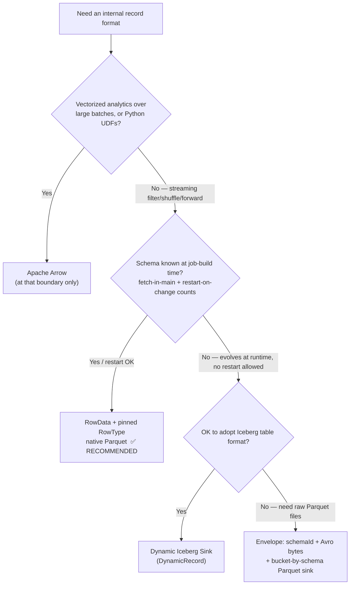
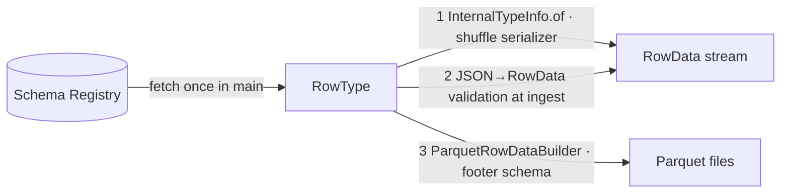
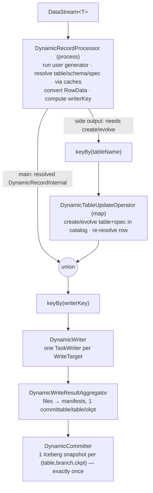
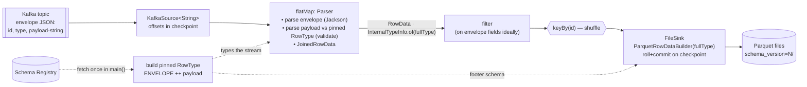

<!-- Local working notes for Claude / engineers. Not for upstream contribution. RAT-excluded. -->

# Choosing an internal record format for a Kafka-JSON → Parquet Flink pipeline: **RowData vs Avro vs Arrow**

A design guide for the recurring question: *"I read JSON from Kafka, validate it against a
schema from a registry, do some filter/shuffle/forward processing, and write Parquet. What should
I carry through the job — Avro, Apache Arrow, or Flink `RowData`? And how do I handle schema
evolution and restarts without losing data?"*

Every API, class, and `file:line` in this doc was read directly from this repo
(`/home/wangh/src/myflink`) and the sibling Iceberg checkout (`/home/wangh/src/myiceberg`), plus
public benchmarks (linked in [§11](#11-references)).

---

## Table of contents

1. [TL;DR / decision cheat-sheet](#1-tldr--decision-cheat-sheet)
2. [What formats Flink actually uses](#2-what-formats-flink-actually-uses)
3. [Why Arrow is the wrong internal format for streaming](#3-why-arrow-is-the-wrong-internal-format-for-streaming)
4. [Row-oriented: RowData vs Avro GenericRecord](#4-row-oriented-rowdata-vs-avro-genericrecord)
5. [The key insight: RowData carries no schema](#5-the-key-insight-rowdata-carries-no-schema)
6. [Schema strategies (pinned / superset / dynamic)](#6-schema-strategies-pinned--superset--dynamic)
7. [What RowType can and can't do vs Avro](#7-what-rowtype-can-and-cant-do-vs-avro)
8. [The Dynamic Iceberg Sink (`DynamicRecord`)](#8-the-dynamic-iceberg-sink-dynamicrecord)
9. [Recommended architecture for the envelope-with-JSON-payload case](#9-recommended-architecture-for-the-envelope-with-json-payload-case)
10. [No-data-loss upgrade / restart flow](#10-no-data-loss-upgrade--restart-flow)
11. [References](#11-references)

---

## 1. TL;DR / decision cheat-sheet

- **Arrow**: only used inside Flink at the **JVM↔Python boundary** for vectorized (Pandas) UDFs
  (`flink-python`). It is columnar/batch — the wrong granularity for a record-at-a-time
  filter/shuffle stream. **Do not use it as your streaming envelope.**
- **RowData** (Flink's native binary row) is the **fastest** in-flight format and writes Parquet
  natively (`ParquetRowDataBuilder`). Use it whenever the schema is known at **job-build time**
  (fetching it in `main()` counts; a restart on schema change is fine).
- **Avro** is still valuable — but at the **edges**: JSON validation / reader-writer schema
  resolution on ingest, and as a fallback carrier only when the schema is truly dynamic and *no
  restart* is allowed. It is not the right *in-flight* carrier when RowData is available.
- **`DynamicRecord`** (Iceberg's Dynamic Sink) gives no-restart schema evolution, but it requires
  adopting **Iceberg tables** (a catalog) instead of raw Parquet files and adds a large amount of
  machinery. Only worth it if you both (a) cannot restart and (b) will adopt Iceberg.



---

## 2. What formats Flink actually uses

### Arrow — narrow, `flink-python` only

The real Apache Arrow library (`org.apache.arrow.*`, `arrow-vector` 13.0.0) is imported by **45
files, all in `flink-python`**. It is used purely as the interchange format for **vectorized
(Pandas) Python UDFs** and `to_pandas()`/`from_pandas()` — i.e. at the JVM↔Python **process
boundary**, batching `RowData` rows into Arrow `RecordBatch`es. The "arrow"-substring hits in
`flink-orc` / `flink-parquet` / `flink-table` are Flink's *own* `ColumnVector` abstraction
(Arrow-*inspired*, not the library). The network shuffle and general operator path use Flink's own
`MemorySegment` + `TypeSerializer` stack — **never Arrow**.

### Avro — a format *and* a core type-system citizen

Avro is used across ~8 modules. Unlike JSON/CSV/Parquet (format-layer only), Avro is the **one
external format wired into Flink's core type system**: `flink-core`'s `AvroUtils`
(`AvroUtils.java:49`) reflectively loads `AvroKryoSerializerUtils` from `flink-avro`, and
`TypeExtractor.java:2013` routes `SpecificRecordBase` types to `AvroTypeInfo` → `AvroSerializer`
(a first-class `TypeSerializer` with schema-evolution via `AvroSerializerSnapshot`). It is also a
format: `AvroFormatFactory`, `AvroRowData(De)serializationSchema`, `AvroParquetWriters`, and the
Confluent registry variants.

### RowData — Flink's native internal row

`RowData` (`flink-table-common/.../table/data/RowData.java`) is the internal binary row used by the
Table/SQL runtime. It is positional (`getInt(0)`, `getString(1)`, `isNullAt(2)`, `getRowKind()`),
has a `MemorySegment`-backed variant (`BinaryRowData`), and writes Parquet/ORC natively. Its
`TypeSerializer` (`RowDataSerializer`, obtained via `InternalTypeInfo.of(RowType)`) is codegen'd
from a concrete `RowType` at job-build time — which is the source of both its speed *and* its
constraints (see [§5](#5-the-key-insight-rowdata-carries-no-schema)).

---

## 3. Why Arrow is the wrong internal format for streaming

Flink is a **row-at-a-time** engine; Arrow is a **columnar batch** format. The granularities are
mismatched, so using Arrow as the streaming envelope pays all the cost and gets none of the benefit:

| Concern | Arrow-as-envelope in a filter/shuffle stream |
|---|---|
| `keyBy` / shuffle | Flink partitions **per record**. A batch-as-record can't be keyed per row without exploding the batch (destroying the columnar layout). |
| `filter` | Removing rows from a columnar batch means compacting every column buffer (a copy). |
| Wire serialization | Flink has **no native Arrow shuffle serializer** — you'd ship Arrow buffers as opaque bytes, paying SerDe cost with zero columnar benefit. |
| Small/variable batches | Streaming batches are small and bursty; Arrow's fixed per-batch overhead (schema, Netty off-heap allocator) amortizes only over large batches. |

Arrow makes sense only for **vectorized analytics over large batches** or **crossing into Python** —
and then only *at that boundary*, converting to Arrow there, never as the pipeline's carrier.

---

## 4. Row-oriented: RowData vs Avro GenericRecord

Once Arrow is out, the real choice is RowData vs Avro `GenericRecord`. The industry consensus and
Flink's own benchmarks put **RowData well ahead**:

- **Flink serializer microbenchmark ordering** (official *Serialization Tuning Vol.1*):
  `Tuple ≈ Row (fastest, reflection-free) > POJO (~30% slower) > Avro generic/specific (slower
  still) > Kryo (64–75% slower)`.
- **Apache Hudi 1.1 / RFC-84** (real Flink ingestion, closest analog): replacing Avro
  `GenericRecord` SerDe with native RowData gave **~25% throughput from serialization alone**, and
  **up to ~3.5× for numeric-heavy schemas**.
- **The Kryo trap** (the #1 gotcha): a bare `GenericRecord` stream *without* pinned
  `TypeInformation` falls back to **Kryo**, which "would serialize the schema into every record,
  over and over again." Always attach `GenericRecordAvroTypeInfo(schema)` or use a
  registry-backed deser if you ever carry `GenericRecord`.

### Performance estimate (where the difference lives)

The two differ **almost entirely at the shuffle (`keyBy`)**; forward/chained edges pass by
reference (no SerDe), and JSON parsing + Parquet writing are shared costs.

| Pipeline profile | RowData advantage over Avro `GenericRecord` |
|---|---|
| Serialization step in isolation (one shuffle hop) | **~2–4× faster** |
| Typical pipeline, 1–2 `keyBy`s, mixed fields | **~15–35% less CPU/time** (matches Hudi's ~25%) |
| Numeric-heavy, small records, multiple shuffles | **~2–3.5× faster** |
| String/blob-heavy, few shuffles, parse/write-dominated | only **~5–15%** |

When the input is an **envelope with a JSON-string payload** (see [§9](#9-recommended-architecture-for-the-envelope-with-json-payload-case)),
the mandatory per-record JSON parse is a large **shared** cost, which *dilutes* the difference —
expect the **lower-to-mid** end (~10–25%) unless the pipeline is shuffle-heavy. In that case the
bigger lever is **filtering on envelope fields *before* parsing the payload**, so dropped records
never pay the parse.

---

## 5. The key insight: RowData carries no schema

`RowData` is a **positional binary tuple**. It has **no field names and no self-description** — the
schema is the **`RowType`**, held *out-of-band* as job-level metadata. This has two consequences:

1. **You do NOT need to convert to Avro to "keep the schema" for Parquet.** The Parquet writer
   takes a `RowType` at build time and writes the schema into the file footer itself:
   `ParquetRowDataBuilder.createWriterFactory(RowType, Configuration, boolean)`
   (`flink-parquet/.../row/ParquetRowDataBuilder.java:111`). Converting
   `RowData → GenericRecord → Parquet` just re-introduces the redundant SerDe Hudi measured at up
   to 3.5×.

2. **RowData's speed is a *build-time bargain*.** `RowDataSerializer` is generated from a concrete
   `RowType` when `StreamGraph.setSerializers(...)` runs (`StreamGraph.java:634`) — before any data
   flows. So RowData is efficient *only when the schema is known at job-build time*. Remove that
   premise (truly per-record dynamic schema) and RowData has no efficient serializer and loses to
   Avro (which was designed for runtime schema resolution).

The three places the schema appears — all out-of-band, none per-record:



---

## 6. Schema strategies (pinned / superset / dynamic)

### 6.1 Pinned at build time — the simple, fast default

"Runtime" that works for RowData means **in `main()`, before `env.execute()`** — Flink captures
`TypeInformation` there. Fetch the schema, build the `RowType`, and the whole pipeline is typed:

```java
// main() — program runtime, before the graph is built
String avroSchemaStr = registry.getLatestSchema(subject);                        // fetched + cached
RowType rowType = (RowType) AvroSchemaConverter.convertToDataType(avroSchemaStr)  // Avro schema → Flink schema
                              .getLogicalType();
TypeInformation<RowData> info = InternalTypeInfo.of(rowType);                     // fast RowDataSerializer
```

The schema is **frozen for the job run**; a new registry version needs a **restart** (see
[§10](#10-no-data-loss-upgrade--restart-flow)). This is the recommended path when restart-on-change
is acceptable.

### 6.2 Superset — reduce restart frequency for *additive* changes

A **superset `RowType`** declares every field you currently receive *plus* fields you anticipate,
all **nullable**. Because the declared column set ⊇ every actual record, additive evolution to an
**already-declared** column needs **no restart** — the mapper simply starts populating a
previously-null column.

```java
// Pinned ONCE: every field you HAVE or ANTICIPATE, extras nullable
RowType superset = RowType.of(
    new LogicalType[]{ new IntType(false),
                       new VarCharType(true, VarCharType.MAX_LENGTH),        // name    (nullable)
                       new VarCharType(true, VarCharType.MAX_LENGTH),        // email   — declared, not sent yet
                       new VarCharType(true, VarCharType.MAX_LENGTH) },      // country — declared, not sent yet
    new String[]{ "id", "name", "email", "country" });

static GenericRowData toRow(JsonNode j) {
    GenericRowData r = new GenericRowData(4);
    r.setField(0, j.get("id").asInt());
    r.setField(1, j.has("name")    ? StringData.fromString(j.get("name").asText())    : null);
    r.setField(2, j.has("email")   ? StringData.fromString(j.get("email").asText())   : null); // absent today → null
    r.setField(3, j.has("country") ? StringData.fromString(j.get("country").asText()) : null);
    return r;
}
```

Timeline of what the superset **covers** (no restart) vs not:

| When | Incoming JSON | Mapper output | Restart? |
|---|---|---|---|
| T0 (v1) | `{"id":101,"name":"alice"}` | `[101,"alice",null,null]` | — baseline |
| T1 — v2 adds `email` ✅ (pre-declared) | `{"id":102,"name":"bob","email":"b@x"}` | `[102,"bob","b@x",null]` | **No restart** |
| T2 — v3 adds `phone` ❌ (not declared) | `{"id":103,...,"phone":"555"}` | `[103,...,null,null]` — `phone` dropped | Redeploy |
| T3 — rename `name`→`full_name` ❌ (breaking) | `{"id":104,"full_name":"dave"}` | `[104,null,null,null]` | Redeploy |

**Covers**: additive change to a field the superset **already declared**. **Does not cover**: a new
field you didn't pre-declare (dropped until redeploy), or any breaking change (rename/type-change/
drop-required). The weakness is that it demands foresight; if restart is acceptable, it's an
*optional* optimization.

### 6.3 Dynamic per-record (envelope + schema-ID) — only when *no restart* is allowed

If the schema is genuinely per-record dynamic and you can't restart, you cannot carry bare typed
RowData (see [§5](#5-the-key-insight-rowdata-carries-no-schema)). Carry an **envelope** whose Java
type is fixed at build time, referencing the schema by **ID**:

```java
class Envelope {                 // fixed type → efficient serializer; NOT bare GenericRecord
    int schemaId;                // 4 bytes on the wire (registry id), NOT the schema
    byte[] avroPayload;          // compact Avro binary, no inline schema
    String partitionKey;         // promote the shuffle key so keyBy needs no decode
    long eventTime;
}
```

Resolve the schema from `schemaId` via a cached registry client (`CachedSchemaCoderProvider` /
`ConfluentRegistryAvroDeserializationSchema.forGeneric(schema, url)` in
`flink-avro-confluent-registry`). Carry the **ID**, never the full schema, across shuffles. At the
sink, bucket by schema version (Parquet files are schema-homogeneous — see below).

---

## 7. What RowType can and can't do vs Avro

`RowData` is a positional tuple; the `RowType` is external metadata. An Avro record is
**self-describing** and **schema-resolution-aware**. That is the whole difference.

**RowData / RowType CAN:**

```java
RowType rt = RowType.of(new LogicalType[]{ new IntType(), new VarCharType(VarCharType.MAX_LENGTH) },
                        new String[]{ "id", "name" });
TypeInformation<RowData> info = InternalTypeInfo.of(rt);   // fast binary shuffle serializer
GenericRowData row = new GenericRowData(2);
row.setField(0, 42); row.setField(1, StringData.fromString("alice"));   // positional, compact
row.setRowKind(RowKind.UPDATE_AFTER);                                   // changelog kind — Avro has no such concept
// native Parquet:
ParquetRowDataBuilder.createWriterFactory(rt, hadoopConf, true);
```

**Avro CAN, RowType CANNOT:**

| Capability | Avro | RowType / RowData |
|---|---|---|
| Self-describing / access by name | `rec.get("id")`, `rec.getSchema()` | positional only; `getField(0)`; lose the `RowType` → bytes are uninterpretable |
| Reader/writer schema **resolution** | `new GenericDatumReader<>(writerSchema, readerSchema)` — fields matched by name, defaults filled, order reconciled | none — a `RowDataSerializer` fed mismatched bytes silently corrupts (positional) |
| Per-field **defaults** for missing fields | `{"name":"email","type":["null","string"],"default":null}` auto-filled | hand-code `if (!json.has(f)) setField(i,null)` |
| **Aliases** (renames) | `{"name":"full_name","aliases":["name"]}` | none — rename is breaking |
| **Compatibility check** | `SchemaCompatibility.checkReaderWriterCompatibility(reader, writer)` | none |
| Schema **fingerprint / identity** | `SchemaNormalization.parsingFingerprint64(schema)` | structural equals only |
| **JSON validation** on decode | `DecoderFactory.get().jsonDecoder(schema, json)` throws on bad data | only what you explicitly check in your mapper |
| Self-contained on the wire / storage | Avro binary + schema is decodable with no prior knowledge | needs the exact `RowType`; Parquet fixes this only at the sink footer |

**RowData CAN, Avro `GenericRecord` CANNOT:** carry `RowKind` (INSERT/UPDATE/DELETE); compact
`MemorySegment`-backed binary rows; native SQL/Table + Parquet/ORC integration.

### The bridge — use both, Flink ships the converters

Idiomatic design: **Avro at the boundaries (validate/resolve/evolve), RowData in the engine (speed)**.

```java
// INGEST edge: validate + resolve with Avro, then convert to RowData for the fast path
AvroToRowDataConverters.AvroToRowDataConverter toRowData =
    AvroToRowDataConverters.createRowConverter(rowType);        // flink-avro
RowData rd = (RowData) toRowData.convert(validatedGenericRecord);
// ... filter / keyBy / forward as RowData ...
// SINK: native Parquet from RowData. (If you must emit Avro instead:)
RowDataToAvroConverters.RowDataToAvroConverter toAvro =
    RowDataToAvroConverters.createConverter(rowType);
```

---

## 8. The Dynamic Iceberg Sink (`DynamicRecord`)

`DynamicRecord` is **not an alternative to Avro** — it is the input type to one specific sink
(`org.apache.iceberg.flink.sink.dynamic.DynamicIcebergSink`) that routes to many Iceberg tables and
**evolves the destination table schema at runtime with no job restart**. Source read from
`/home/wangh/src/myiceberg/flink/v2.1/.../sink/dynamic/`.

`DynamicRecord.java:30-40` — the payload is **`RowData`**, and the schema is an **Iceberg** `Schema`:

```java
public class DynamicRecord {
  private TableIdentifier tableIdentifier;   // which table
  private String branch;
  private Schema schema;                      // org.apache.iceberg.Schema — carried WITH the record
  private RowData rowData;                     // the payload is RowData
  private PartitionSpec partitionSpec;
  private DistributionMode distributionMode;
  private int writeParallelism;
  ...
}
```

### How it evolves schema without a restart

1. **Schema is runtime *data*, not a compile-time *type*.** The stream element type is fixed
   (`DynamicRecordInternal`); each record *carries* a `Schema` + `RowData` as data. The job graph
   never changes. This is the escape hatch around the build-time serializer binding from
   [§5](#5-the-key-insight-rowdata-carries-no-schema).
2. **Per-record comparison** against a cached table schema (`DynamicRecordProcessor` →
   `TableMetadataCache.schema(...)` → `CompareSchemasVisitor`): `SAME` / `DATA_CONVERSION_NEEDED`
   (adapt the row) / `SCHEMA_UPDATE_NEEDED` (evolve the table).
3. **`SCHEMA_UPDATE_NEEDED` → a metadata-only catalog commit** (`EvolveSchemaVisitor` →
   Iceberg `UpdateSchema`: addColumn / widen / make-optional). **Iceberg stores schema as
   metadata**, so adding a column never rewrites existing Parquet files.
4. **The shuffle carries a compact schema-ID.** `DynamicRecordInternalSerializer.java:92` writes
   `schema().schemaId()` (an int) on the main path and reconstructs the serializer from a cache;
   only the table-update side-output writes full schema JSON. (This is exactly the
   [§6.3](#63-dynamic-per-record-envelope--schema-id-only-when-no-restart-is-allowed) envelope
   pattern, productionized.)
5. **Caches** (`TableMetadataCache`, keyed by the reused `Schema` instance) keep the per-record
   check cheap; the catalog is hit only on the slow path.

Operator topology (from the deep-dive at `/home/wangh/src/myiceberg/codedocs/flink-dynamic-iceberg-sink-deep-dive.md`):



### Why not just Avro? Read-side vs write-side schema evolution

A common objection: *"Avro already supports schema evolution and needs no restart — why do I need
`DynamicRecord`?"* This conflates **two different** evolution problems. Avro solves one; it cannot
solve the other at all.

| | **Read side** (decode incoming evolved data) | **Write side** (emit the new column to the sink) |
|---|---|---|
| Meaning | Producer changed the schema; you must parse the new bytes | The **output** (Parquet footer / table schema) must gain the column |
| Avro, no restart? | ✅ Yes — reader/writer schema resolution at deserialize time | ❌ No — the writer's schema is fixed at construction |
| Who removes the restart? | Avro + registry | **DynamicIcebergSink** (Iceberg catalog) — *not* Avro |

**Read side — Avro needs no restart (confirmed).** `ConfluentSchemaRegistryCoder.readSchema`
(`flink-avro-confluent-registry/.../ConfluentSchemaRegistryCoder.java:65`) reads the 4-byte schema
id per message and calls `schemaRegistryClient.getById(schemaId)` — resolving the **writer** schema
at runtime, per record. Avro's resolution rules (match by name, ignore extra writer fields, fill new
fields from defaults) run only during deserialization. Decoding evolved data needs no restart.

**Write side — Avro cannot help; this is where the restart comes from.** The writer's schema is
baked in at construction, regardless of the in-flight format:

- `AvroParquetWriters.forGenericRecord(Schema schema)` (`AvroParquetWriters.java:63`) — schema is a
  **constructor argument**. One writer = one schema.
- `ParquetRowDataBuilder.createWriterFactory(RowType, …)` (`ParquetRowDataBuilder.java:111`) — fixed
  `RowType`.

So even carrying Avro `GenericRecord`s in-flight, a plain `FileSink` Parquet writer must commit to
one schema; writing a **new column** means rebuilding the sink → **restart**. Avro is a
(de)serialization format — it has no notion of a destination table whose schema it manages, and no
way to reconfigure a running writer.

**Why `DynamicRecord` removes the write-side restart** (confirmed in Iceberg source) — it does two
things Avro fundamentally cannot:

1. **New writer per schema at runtime** — `DynamicWriter.java:133` builds a fresh
   `RowDataTaskWriterFactory` keyed by `WriteTarget` (which includes `schema().schemaId()`) via
   `FlinkSchemaUtil.convert(element.schema())`. New schema → new writer, live, no restart.
2. **Evolves the destination *table* as catalog metadata** — `TableUpdater.java:149`
   `table.updateSchema()` → `EvolveSchemaVisitor.addColumn/updateColumn` (`:205,:210`) →
   `commit()`. Iceberg schema changes are **metadata-only** (permanent column IDs; existing files
   return `null` for the new column; no data rewrite).

Neither is an Avro capability. Summary — *does Avro need a restart?*

```
                     READ evolved data      WRITE new column to output
Avro + registry       ✅ no restart           ❌ writer schema fixed at build
  (in-flight)         (resolve by id)           → raw Parquet: RESTART (Avro can't change this)
DynamicIcebergSink    payload is RowData;     ✅ no restart
                      Avro only upstream        (new writer per schema at runtime
                      to parse                   + Iceberg UpdateSchema metadata commit)
```

**Applied to this pipeline:** carrying **RowData** into a `FileSink` Parquet writer with
restart-on-change, switching the in-flight format to Avro would **not** remove the restart — the
restart is imposed by the fixed-schema `FileSink`, not by RowData. Avro would only change how you
*decode* input, not how you *evolve the Parquet output*. To write new columns without a restart you
need either DynamicIcebergSink (adopt Iceberg) or a hand-built schema-version-bucketing Parquet sink
(heterogeneous files, reader merges) — neither is "just use Avro."

### Is it "better than Avro"? For the restart-OK case — don't use it

`DynamicRecord`/`DynamicIcebergSink` exists to eliminate exactly the restart you're willing to
accept, and it forces a large commitment:

- Writes **Iceberg tables**, not raw Parquet files; requires an **Iceberg catalog**
  (Hive/REST/Glue/Nessie). Consumers read "a table," not files.
- `@Experimental` API.
- Five-operator topology + two-phase commit + manifests; you still write a `DynamicRecordGenerator`
  that produces `(TableIdentifier, branch, Iceberg Schema, RowData, PartitionSpec, …)` per record —
  so your registry/validation work doesn't disappear, it moves into the generator (and now you
  build Iceberg `Schema`s too).

**Use it only if you both (a) cannot restart and (b) will adopt Iceberg.** With restart accepted and
raw-Parquet output desired, it is unnecessary complexity — keep the pinned-RowData path.

Mental model: **Avro = validate/resolve incoming data; RowData = fast payload; DynamicRecord =
no-restart destination-table evolution on Iceberg.** They're layers, not competitors.

---

## 9. Recommended architecture for the envelope-with-JSON-payload case

**Scenario:** each Kafka record is an envelope `{ id, type, …, payload }` where `payload` is a JSON
**string** whose schema lives in a registry; restart on schema change is acceptable; output is raw
Parquet files.

**Approach:** split the schema — fixed envelope columns + registry-derived payload columns → one
pinned `fullType`. Parse the payload once at the source into `RowData`, carry RowData through
filter/shuffle, write native Parquet. No Avro in the data path (optionally use Avro/JSON validation
at ingest only).



### Code

```java
public class PayloadToParquet {

  // Envelope columns kept in the output (fixed, known at build time)
  static final RowType ENVELOPE = RowType.of(
      new LogicalType[]{ new BigIntType(false), new VarCharType(true, VarCharType.MAX_LENGTH) },
      new String[]     { "id",                  "type" });

  public static void main(String[] args) throws Exception {
    StreamExecutionEnvironment env = StreamExecutionEnvironment.getExecutionEnvironment();

    // (1) checkpointing — REQUIRED for offset tracking + Parquet commit + no-loss restart
    env.enableCheckpointing(60_000, CheckpointingMode.EXACTLY_ONCE);
    env.getCheckpointConfig().setCheckpointStorage("s3://bucket/checkpoints");
    env.getCheckpointConfig().setExternalizedCheckpointCleanup(RETAIN_ON_CANCELLATION);

    // (2) fetch payload schema from the registry ONCE, build the pinned target RowType
    String payloadAvroSchema = SchemaRegistry.fetchLatest("orders-payload");     // your registry client
    RowType payloadType = (RowType) AvroSchemaConverter.convertToDataType(payloadAvroSchema).getLogicalType();
    RowType fullType = concat(ENVELOPE, payloadType);            // [id, type] ++ payload columns
    InternalTypeInfo<RowData> fullInfo = InternalTypeInfo.of(fullType);

    // (3) Kafka source — offsets stored in checkpoints/savepoints, not Kafka auto-commit
    KafkaSource<String> source = KafkaSource.<String>builder()
        .setBootstrapServers("broker:9092").setTopics("requests").setGroupId("payload-parquet")
        .setStartingOffsets(OffsetsInitializer.committedOffsets(OffsetResetStrategy.EARLIEST))
        .setValueOnlyDeserializer(new SimpleStringSchema())
        .build();

    // (4) pipeline — STABLE .uid() on every operator so savepoints map across upgrades
    DataStream<RowData> rows = env
        .fromSource(source, WatermarkStrategy.noWatermarks(), "kafka").uid("src-kafka")
        .flatMap(new Parser(payloadType)).returns(fullInfo).uid("parse")
        .filter(r -> !r.isNullAt(0)).uid("filter");

    rows.keyBy(r -> r.getLong(0)).uid("keyby")
        .sinkTo(FileSink
            .forBulkFormat(new Path("s3://bucket/out"),
                ParquetRowDataBuilder.createWriterFactory(fullType, new Configuration(), true))
            .withRollingPolicy(OnCheckpointRollingPolicy.build())   // roll+commit files on checkpoint
            .build())
        .uid("sink-parquet");

    env.execute("payload-to-parquet");
  }

  static RowType concat(RowType a, RowType b) {
    List<RowType.RowField> f = new ArrayList<>(a.getFields());
    f.addAll(b.getFields());
    return new RowType(false, f);
  }

  /** Parse envelope (Jackson) + payload (schema-driven, validated) → one RowData. */
  static final class Parser extends RichFlatMapFunction<String, RowData> {
    private final RowType payloadType;
    private transient ObjectMapper mapper;
    private transient JsonRowDataDeserializationSchema payloadDeser;

    Parser(RowType payloadType) { this.payloadType = payloadType; }

    @Override public void open(OpenContext ctx) {
      mapper = new ObjectMapper();
      payloadDeser = new JsonRowDataDeserializationSchema(
          payloadType, InternalTypeInfo.of(payloadType),
          /*failOnMissingField*/ true,    // validation: required payload field missing => error
          /*ignoreParseErrors*/  false,   // strict: malformed payload => error
          TimestampFormat.ISO_8601);
    }

    @Override public void flatMap(String record, Collector<RowData> out) throws Exception {
      try {
        JsonNode envelope = mapper.readTree(record);
        GenericRowData envRow = new GenericRowData(2);            // envelope columns
        envRow.setField(0, envelope.get("id").asLong());
        envRow.setField(1, StringData.fromString(envelope.get("type").asText()));
        byte[] payloadBytes = envelope.get("payload").asText().getBytes(StandardCharsets.UTF_8);
        RowData payloadRow = payloadDeser.deserialize(payloadBytes);   // parse + VALIDATE payload
        out.collect(new JoinedRowData(envRow, payloadRow));            // zero-copy concat → fullType
      } catch (Exception e) {
        // NO-DATA-LOSS on bad records: route to a dead-letter side output (use a ProcessFunction)
        // instead of throwing — a thrown exception restarts the job and loops on a poison record.
      }
    }
  }
}
```

**Optimization note:** if you filter on **envelope** fields (`id`, `type`), split the parse —
parse the envelope, `filter`, *then* parse the payload — so records you drop never pay the expensive
payload parse. That usually saves more CPU than the RowData-vs-Avro choice itself. (If you `keyBy` a
**payload** field, you must parse before the shuffle and can't defer.)

**Output boundary:** files written before a schema upgrade have the old schema, after have the new.
Partition output by schema version (`.../schema_version=<n>/` via a `BucketAssigner`) so each
directory is schema-homogeneous and readers never see a mixed set. For additive changes,
Spark/Trino/Hive schema-merge also reads mixed files fine.

---

## 10. No-data-loss upgrade / restart flow

The guarantee rests on three Flink mechanisms the code above enables:

1. **Kafka offsets live in the checkpoint/savepoint** (not Kafka auto-commit) → restore rewinds to
   the exact offset.
2. **Bulk Parquet files commit only on a successful checkpoint** (`OnCheckpointRollingPolicy`) →
   in-progress files are invisible until then; a clean stop commits all pending output.
3. **stop-with-savepoint** flushes and commits everything atomically before stopping.

```mermaid
sequenceDiagram
    autonumber
    participant Op as Operator
    participant Reg as Schema Registry
    participant Job as Flink job (old schema)
    participant SP as Savepoint store
    participant K as Kafka
    participant FS as Parquet output

    Note over Job: running; offsets & pending files tracked in checkpoints
    Op->>Reg: publish new payload schema (v2)
    Op->>Job: flink stop --savepointPath ...
    Job->>FS: commit ALL pending Parquet files (old schema)
    Job->>SP: write savepoint (Kafka offsets + FileSink state)
    Job-->>Op: stopped, returns savepoint path
    Op->>Job: flink run -s <savepoint> newJar
    Note over Job: main() fetches v2 schema → new fullType (new RowType)
    Job->>SP: restore offsets + sink state
    Job->>K: resume from saved offsets (no gap, no source dup)
    Job->>FS: write new Parquet files (schema_version=N+1)
```

### Procedure

1. **Publish** the new schema to the registry (new version). Leave the running job alone.
2. **Stop the old job with a savepoint** (do **not** `--drain` for upgrade-and-continue; drain is
   for terminal shutdown):
   ```
   flink stop --savepointPath s3://bucket/savepoints <jobId>
   ```
   Commits all pending Parquet files (old schema) and records exact next-unread offsets. **Never**
   just cancel/kill — that discards everything written since the last checkpoint.
3. **Start the new job from the savepoint** (its `main()` fetches the new schema → new `fullType`):
   ```
   flink run -s s3://bucket/savepoints/savepoint-xxxx <newJar>
   ```
   Resumes from saved offsets → **no record skipped (no loss), none reprocessed (no source dup).**
4. **Verify** the new job consumes from the savepoint offsets and writes new-schema Parquet files.

### Why no data loss

- **No gap** → resume from exact offsets in the savepoint.
- **No lost output** → pending Parquet committed at the stop-savepoint.
- **No source duplicates** → offset-based resume; FileSink is exactly-once (commit-on-checkpoint),
  so a mid-run crash-replay never double-writes.
- The only cost is a short pause between stop and start; Kafka retains the data during that window.

### State caveat (keeps restarts clean across schema changes)

Because this pipeline is effectively **stateless** (map/filter/keyBy/sink; no user keyed state
holding RowData), the only restored state is Kafka offsets + FileSink pending-file bookkeeping —
both schema-agnostic — so the new `RowType` restores cleanly and you typically **don't** need
`--allowNonRestoredState`.

⚠️ If you *did* keep parsed `RowData` in long-lived **keyed state**, its serializer snapshot may be
incompatible with the new schema and restore would fail. **Keep schema-typed `RowData` out of keyed
state**; if unavoidable, migrate the state or use `--allowNonRestoredState` (only if that state is
rebuildable). This is the area FLIP-527 (*State Schema Evolution for RowData*) is improving.

### Crash recovery (not an upgrade) is also no-loss

On failure Flink auto-restores from the last completed checkpoint: offsets rewind, and any Parquet
written after that checkpoint was never committed (`.inprogress`), so it is cleaned up and
rewritten — exactly-once, no partial files visible.

---

## 11. References

### Source read for this doc

- Flink: `flink-core/.../typeutils/AvroUtils.java`, `.../TypeExtractor.java:2013`,
  `.../kryo/KryoSerializer.java`; `flink-formats/flink-avro/.../typeutils/{AvroSerializer,
  GenericRecordAvroTypeInfo}.java`, `.../AvroSchemaConverter.java`,
  `.../{AvroToRowDataConverters,RowDataToAvroConverters}.java`;
  `flink-formats/flink-parquet/.../row/ParquetRowDataBuilder.java:111`,
  `.../avro/AvroParquetWriters.java:63`;
  `flink-formats/flink-json/.../JsonRowDataDeserializationSchema.java:55`;
  `flink-formats/flink-avro-confluent-registry/.../ConfluentRegistryAvroDeserializationSchema.java`;
  `flink-table/flink-table-common/.../data/{RowData,GenericRowData}.java`,
  `.../data/utils/JoinedRowData.java`, `.../types/logical/RowType.java:289`;
  `flink-table/flink-table-runtime/.../typeutils/InternalTypeInfo.java:88`;
  `flink-runtime/.../streaming/api/graph/StreamGraph.java:634`;
  `flink-python/.../table/runtime/arrow/serializers/ArrowSerializer.java`.
- Iceberg: `/home/wangh/src/myiceberg/flink/v2.1/.../sink/dynamic/{DynamicRecord,
  DynamicRecordProcessor,DynamicTableUpdateOperator,DynamicRecordInternalSerializer,
  DynamicWriter.java:133,TableUpdater.java:149,EvolveSchemaVisitor.java:205}.java` and
  `/home/wangh/src/myiceberg/codedocs/flink-dynamic-iceberg-sink-deep-dive.md`.

### Web (benchmarks / best practices)

- Flink Serialization Tuning Vol. 1 — <https://flink.apache.org/2020/04/15/flink-serialization-tuning-vol.-1-choosing-your-serializer-if-you-can/>
- Avro 1.11 Specification — Schema Resolution (reader/writer rules, deserialize-time) — <https://avro.apache.org/docs/1.11.1/specification/>
- Martin Kleppmann — Schema evolution in Avro, Protocol Buffers and Thrift — <https://martin.kleppmann.com/2012/12/05/schema-evolution-in-avro-protocol-buffers-thrift.html>
- Apache Iceberg — Schema Evolution (metadata-only, column IDs, no rewrite) — <https://iceberg.apache.org/docs/latest/evolution/>
- Apache Hudi 1.1 Deep Dive (RowData vs Avro; ~25% / up to 3.5×) — <https://hudi.apache.org/blog/2025/12/10/apache-hudi-11-deep-dive-optimizing-streaming-ingestion-with-flink/>
- From Stream to Lakehouse: Flink Dynamic Iceberg Sink — <https://flink.apache.org/2025/11/11/from-stream-to-lakehouse-kafka-ingestion-with-the-flink-dynamic-iceberg-sink/>
- Iceberg Flink Writes (`AvroGenericRecordToRowDataMapper`, dynamic sink) — <https://iceberg.apache.org/docs/nightly/flink-writes/>
- FLIP-527: State Schema Evolution for RowData — <https://cwiki.apache.org/confluence/display/FLINK/FLIP-527:+State+Schema+Evolution+for+RowData>
- flink-benchmarks `SerializationFrameworkMiniBenchmarks` (JMH) — <https://github.com/dataArtisans/flink-benchmarks/blob/master/src/main/java/org/apache/flink/benchmark/SerializationFrameworkMiniBenchmarks.java>
- How (not) to sink a data stream to files (bol.com; raw-Parquet pitfalls) — <https://techlab.bol.com/en/blog/how-not-to-sink-a-data-stream-to-files-journeys-from-kafka-to-parquet/>

> Accuracy caveat: code snippets are illustrative (imports elided; not compiled as part of writing
> this doc). API signatures and `file:line` references were read from the source trees above.
