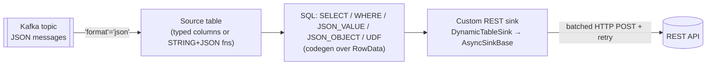
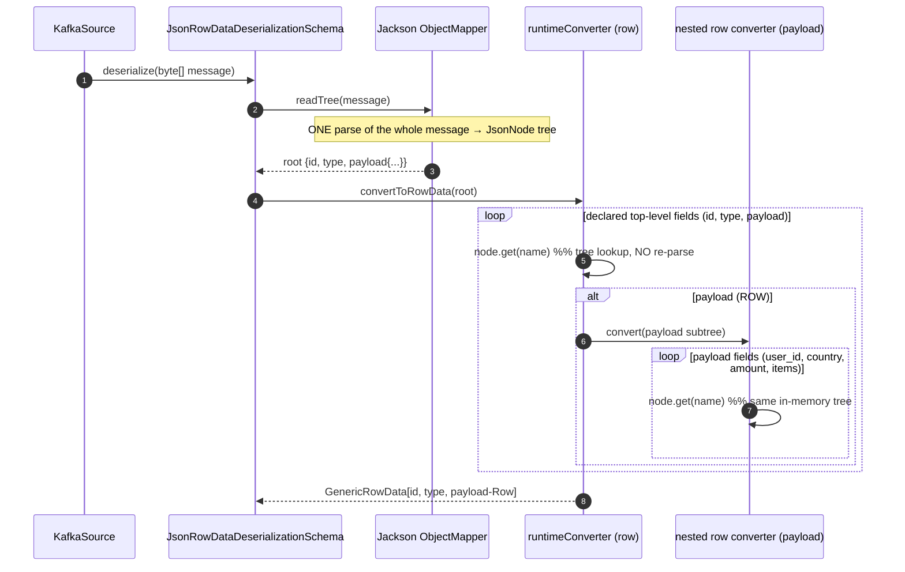
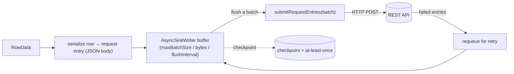

<!-- Local working notes for Claude / engineers. Not for upstream contribution. RAT-excluded. -->

# Flink SQL for JSON conversion → REST-API sink: how it works, UDFs, performance, and is it the right tool

Companion to `flink-json-kafka-to-parquet-rowdata-vs-avro.md`. That doc answered *"what internal
format for a Kafka-JSON → **Parquet** pipeline (DataStream)."* This one answers a different shape:

> *"I have Kafka JSON payloads. I want to use **Flink SQL** to convert them, then **POST the result
> to a REST API**. How does Flink SQL support JSON? Is it standard SQL or does it need UDFs? How do
> custom UDFs and a custom REST sink work? What's the performance? Is Flink SQL even the right
> tool here?"*

Every class / `file:line` was read from this repo (`/home/wangh/src/myflink`).

---

## Table of contents

1. [TL;DR](#1-tldr)
2. [How Flink SQL supports JSON — two layers](#2-how-flink-sql-supports-json--two-layers)
3. [What the SQL looks like](#3-what-the-sql-looks-like)
4. [Standard SQL, or UDF extensions?](#4-standard-sql-or-udf-extensions)
5. [Custom UDFs](#5-custom-udfs)
6. [Performance](#6-performance)
7. [The REST-API sink (there is no built-in one)](#7-the-rest-api-sink-there-is-no-built-in-one)
8. [Evaluation: is Flink SQL a good tool for this?](#8-evaluation-is-flink-sql-a-good-tool-for-this)
9. [References](#9-references)

---

## 1. TL;DR

- **JSON in** is first-class: `'format' = 'json'` on a Kafka table parses each message into typed
  columns (incl. nested `ROW`/`ARRAY`/`MAP`). For dynamic JSON, declare a `STRING` column and use
  the **SQL:2016 JSON functions** (`JSON_VALUE`, `JSON_QUERY`, `JSON_OBJECT`, …) that Flink supports
  natively — no UDF needed for extraction/construction.
- **The conversion is mostly plain SQL.** Flink SQL is ANSI-SQL (Apache Calcite) plus streaming
  extensions. UDFs are the escape hatch for logic SQL can't express.
- **Performance is good**: the planner does whole-stage **code generation** (Janino) over binary
  `RowData`, comparable to hand-written DataStream, often better (projection/filter pushdown).
- **The REST sink is the weak spot**: Flink has **no built-in HTTP/REST sink**. You build a custom
  `DynamicTableSink` on top of `AsyncSinkBase` (batching + retry), and you get **at-least-once**
  (duplicates on retry) unless the API is idempotent.
- **Verdict**: great for the JSON parse+transform; acceptable for the REST egress *if* the target is
  idempotent/batch-friendly. For complex per-record egress control or exactly-once to a
  non-idempotent API, prefer a **DataStream job** (or a hybrid: SQL transform → `toDataStream` →
  custom async sink), or an out-of-band egress (Kafka Connect HTTP sink).



---

## 2. How Flink SQL supports JSON — two layers

### Layer 1 — the JSON *format* (declarative parsing)

`flink-json`'s `JsonFormatFactory` wires `JsonRowDataDeserializationSchema`
(`JsonRowDataDeserializationSchema.java:55`) into any connector. In DDL you declare the schema as
columns; the format (Jackson) maps each JSON message into a typed `RowData`. Nested JSON maps to
`ROW<...>`, arrays to `ARRAY<...>`, objects to `MAP<...>`. Options:
`json.fail-on-missing-field`, `json.ignore-parse-errors`, `json.timestamp-format.standard`
(`SQL` vs `ISO-8601`), `json.map-null-key.mode`, etc.

> Gotcha (from `flink-formats/CLAUDE.md`): the JSON format needs a **static** `RowType`. For truly
> dynamic JSON, keep the field as `STRING` and use JSON functions (Layer 2). This is the same
> pinned-vs-dynamic schema tension covered in the companion doc.

**How the typed `ROW` parses the message once** — the single parse is `readTree`; everything after
is in-memory tree navigation (confirmed path: `AbstractJsonDeserializationSchema.deserialize:115` →
`deserializeToJsonNode:104` = `objectMapper.readTree(message)` → `convertToRowData:107` →
`JsonToRowDataConverters.createRowConverter:342-357` looping `node.get(fieldName)` over **declared**
fields; nested `ROW` = a nested converter over the same subtree):



The whole message — nested `payload` and its arrays included — is parsed **once**; each column is
then a cheap `get()` on the tree. That is why one `ROW` beats N `JSON_VALUE` calls (each re-scans).

### Worked example — `id INT`, `type STRING`, `payload ROW<...>`

```sql
CREATE TABLE requests (
  id       INT,
  `type`   STRING,                              -- reserved word → backtick
  payload  ROW< user_id BIGINT, country STRING, amount DECIMAL(10,2),
                items ARRAY<ROW<sku STRING, qty INT>> >,
  ts       TIMESTAMP_LTZ(3) METADATA FROM 'timestamp' VIRTUAL
) WITH (
  'connector' = 'kafka', 'topic' = 'requests',
  'properties.bootstrap.servers' = 'broker:9092', 'properties.group.id' = 'converter',
  'scan.startup.mode' = 'group-offsets',
  'format' = 'json',
  'json.fail-on-missing-field' = 'false',       -- absent field → NULL
  'json.ignore-parse-errors'   = 'false'
);

SELECT id, `type`, payload.user_id, UPPER(payload.country) AS country,
       payload.amount, CARDINALITY(payload.items) AS item_count
FROM requests
WHERE `type` = 'ORDER' AND payload.amount > 0;
```

(If `payload` arrives as an **escaped JSON string** rather than a nested object, declare it `STRING`
and use `JSON_VALUE`/`PARSE_JSON` instead of `ROW`.)

### Payload as a JSON *string*: DataStream two-level parse → SQL (hybrid)

When the record is `{id, type, payload}` and **`payload` is itself a JSON string**, pure SQL can't
parse it into typed columns without `JSON_VALUE`-per-field (N re-scans). Parse it **once** in a
DataStream `flatMap` into a typed `ROW`, then bridge to SQL:

```java
static final class ParsePayload extends RichFlatMapFunction<String, RowData> {
  private final RowType payloadType;                       // pinned schema of the JSON string
  private transient ObjectMapper mapper;
  private transient JsonParserRowDataDeserializationSchema payloadDeser;
  @Override public void open(OpenContext ctx) throws Exception {
    mapper = new ObjectMapper();
    payloadDeser = new JsonParserRowDataDeserializationSchema(   // ← parser variant (see below)
        payloadType, InternalTypeInfo.of(payloadType), false, false, TimestampFormat.ISO_8601);
    payloadDeser.open(null);
  }
  @Override public void flatMap(String rec, Collector<RowData> out) throws Exception {
    JsonNode outer = mapper.readTree(rec);                       // small outer parse
    GenericRowData head = new GenericRowData(2);
    head.setField(0, outer.get("id").asInt());
    head.setField(1, StringData.fromString(outer.get("type").asText()));
    RowData payload = payloadDeser.deserialize(                  // ONE typed parse of the payload string
        outer.get("payload").asText().getBytes(StandardCharsets.UTF_8));
    if (payload != null) out.collect(new JoinedRowData(head, payload));   // [id,type, …payload cols]
  }
}
// bridge — emit RowData + InternalTypeInfo(outType) so the Table conversion is near zero-copy
DataStream<RowData> rows = env.fromSource(src, wm, "kafka")
    .flatMap(new ParsePayload(payloadType)).returns(InternalTypeInfo.of(outType));
tEnv.createTemporaryView("events", rows);
tEnv.sqlQuery("SELECT id, `type`, user_id, UPPER(country) FROM events WHERE `type`='ORDER'");
```

**Performance:** the payload is parsed **once** (beats pure-SQL `JSON_VALUE`-per-field = N parses for
a string-in-string payload); the parser variant skips unused/wide fields; and the DataStream→Table
bridge is near-zero-cost **iff** you emit `RowData` + `InternalTypeInfo` (emitting `Row` inserts a
per-record `DataStructureConverter`). SQL operators are codegen'd over `RowData` — pure-SQL speed.

### Selecting `JsonParserRowDataDeserializationSchema` vs `JsonRowDataDeserializationSchema`

- **DataStream:** just construct the one you want (identical args); add `String[][] projectedFields`
  to the parser ctor for projection pushdown.
- **SQL / `json` format:** the parser variant is the **default** — `JsonFormatFactory` selects it when
  `decode.json-parser.enabled` is true, and it is **`true` by default** (`JsonFormatOptions.java:83-88`).
  Force the DOM path with `'json.decode.json-parser.enabled' = 'false'`.

### Layer 2 — the SQL/JSON *functions* (SQL:2016)

Flink registers the standard SQL:2016 JSON operators (confirmed in
`FlinkSqlOperatorTable.java`), runtime in `SqlJsonUtils.java` (Jackson + JSONPath):

| Function | Purpose |
|---|---|
| `JSON_VALUE(json, '$.a.b' RETURNING <type>)` | extract a **scalar** by JSONPath |
| `JSON_QUERY(json, '$.a')` | extract an **object/array** (as JSON string) |
| `JSON_EXISTS(json, '$.a')` | does the path exist (boolean) |
| `x IS JSON [VALUE/OBJECT/ARRAY/SCALAR]` | validity test |
| `JSON_OBJECT('k' VALUE v, …)` / `JSON_ARRAY(…)` | **construct** JSON |
| `JSON_OBJECTAGG` / `JSON_ARRAYAGG` | aggregate rows into a JSON object/array |
| `JSON_SCALAR`, `JSON_QUOTE`, `JSON_UNQUOTE` (`JsonUnquoteFunction`) | Flink extras: wrap/quote/unquote |

So "convert JSON" splits into **read** (`JSON_VALUE`/`JSON_QUERY` or typed `ROW` columns) and
**write** (`JSON_OBJECT`/`JSON_ARRAY`, or the `json` format on the sink side).

---

## 3. What the SQL looks like

### Idiom A — declare the payload structure (pinned schema, fastest)

```sql
CREATE TABLE requests (
  id        BIGINT,
  `type`    STRING,
  payload   ROW<user_id BIGINT, country STRING, amount DECIMAL(10,2)>,   -- nested JSON → typed ROW
  event_ts  TIMESTAMP(3) METADATA FROM 'timestamp',
  WATERMARK FOR event_ts AS event_ts - INTERVAL '5' SECOND
) WITH (
  'connector' = 'kafka',
  'topic' = 'requests',
  'properties.bootstrap.servers' = 'broker:9092',
  'format' = 'json',
  'json.fail-on-missing-field' = 'false',
  'json.ignore-parse-errors'   = 'false'      -- strict = validation
);

-- transform
SELECT id, payload.user_id, UPPER(payload.country) AS country, payload.amount
FROM requests
WHERE `type` = 'ORDER' AND payload.amount > 0;
```

### Idiom B — payload as STRING + JSON functions (dynamic schema)

```sql
CREATE TABLE requests_raw (
  id BIGINT, `type` STRING, payload STRING          -- payload kept opaque
) WITH ('connector'='kafka', 'topic'='requests', 'format'='json', ...);

SELECT
  id,
  JSON_VALUE(payload, '$.user.id' RETURNING BIGINT)  AS user_id,
  JSON_VALUE(payload, '$.country')                   AS country,
  JSON_QUERY(payload, '$.items')                     AS items_json,   -- sub-array as JSON string
  JSON_EXISTS(payload, '$.coupon')                   AS has_coupon
FROM requests_raw
WHERE `type` = 'ORDER' AND JSON_VALUE(payload, '$.status') = 'NEW';
```

### Idiom C — fully dynamic JSON: `VARIANT` / `PARSE_JSON`

Is there a "JSON table / JSON type"? Two answers:

- **A semi-structured `VARIANT` type — yes.** Flink 2.x has `VARIANT`
  (`flink-table-common/.../logical/VariantType.java`, `flink-core/.../types/variant/Variant.java`)
  plus `PARSE_JSON(str)` / `TRY_PARSE_JSON(str)` (confirmed in `FlinkSqlOperatorTable`; runtime
  `ParseJsonFunction` / `TryParseJsonFunction`). `VARIANT` holds arbitrary JSON with **no column
  declaration** — the closest thing to a first-class "JSON column type" for genuinely dynamic
  documents. Use `TRY_PARSE_JSON` to get `NULL` instead of an error on malformed input.
- **A `JSON_TABLE` function — no.** Flink does **not** implement SQL:2016 `JSON_TABLE` (the
  JSON→relational-table operator; grep count `0` in `FlinkSqlOperatorTable`). To turn a JSON array
  into rows, extract it as an `ARRAY` column and `CROSS JOIN UNNEST(...)`, or write a
  `TableFunction` UDF.

### "Field A present → value, else ignore / NULL" (dynamic schema)

This is the **default** behavior — no special handling required:

```sql
SELECT
  id,
  JSON_VALUE(payload, '$.A')                         AS a,         -- present → value, ABSENT → NULL (default)
  JSON_VALUE(payload, '$.A' DEFAULT 'n/a' ON EMPTY)  AS a_or_def,  -- or supply your own default
  JSON_EXISTS(payload, '$.A')                        AS has_a      -- explicit presence test (boolean)
FROM requests_raw;

-- If instead you want to DROP (ignore) rows where A is absent:
SELECT ... FROM requests_raw WHERE JSON_EXISTS(payload, '$.A');
-- equivalently: WHERE JSON_VALUE(payload, '$.A') IS NOT NULL
```

`JSON_VALUE` returns **NULL when the path doesn't match** (Calcite `NULL ON EMPTY` default); override
with `DEFAULT <x> ON EMPTY` or `ERROR ON EMPTY`. The typed-`ROW` approach (Idiom A) behaves the same:
a missing field is `NULL` when `'json.fail-on-missing-field' = 'false'` (the default). So
"present → value, absent → NULL" needs **zero extra code**; add `WHERE JSON_EXISTS(...)` only when you
want to *drop* such rows rather than null-fill them.

For a document whose fields are entirely unknown up front, `PARSE_JSON(payload)` into a `VARIANT`
avoids declaring any columns, and per-path extraction with `JSON_VALUE` / `JSON_EXISTS` on the raw
`STRING` gives the same present-else-NULL semantics field by field.

### What if the JSON gains new columns, or I don't have the schema?

**Typed `ROW` tolerates *added* JSON fields — it silently ignores them.** `createRowConverter`
(`JsonToRowDataConverters.java:334-358`) iterates over the **declared** fields and looks each up by
name (`node.get(fieldName)`); it never scans the JSON's own key set. So the converter is tolerant on
both sides:

| Situation (`json.fail-on-missing-field=false`, default) | Behavior |
|---|---|
| Declared field present | value extracted |
| Declared field absent | `NULL` |
| JSON field **not** declared in the `ROW` (new/extra column) | **ignored** — no error, no breakage |

So **additive JSON evolution does not break a typed-`ROW` job** — a new upstream field costs nothing
until you choose to capture it. To *surface* the new field you add it to the `ROW` (DDL change →
redeploy), or pre-declare anticipated fields (they read `NULL` until they appear — no restart).

**If you don't have the schema**, `ROW` only covers what you can name; use one (or a mix) of:

```sql
-- (1) PARTIAL ROW — declare only known fields; the rest are ignored
payload ROW<user_id BIGINT, country STRING>

-- (2) STRING + JSON functions — name only the paths you want, no full schema needed
SELECT id, JSON_VALUE(payload,'$.user_id' RETURNING BIGINT) AS user_id,
           JSON_VALUE(payload,'$.maybe_new') AS maybe_new           -- absent→NULL, appears later→value
FROM t;                                                              -- (t.payload is STRING)

-- (3) PARSE_JSON → VARIANT — arbitrary doc, zero columns declared
SELECT id, PARSE_JSON(payload) AS doc FROM t;
```

**Pragmatic hybrid:** extract the fields you query often *and keep the raw payload* so future fields
stay reachable without a redeploy — and if you forward `raw_payload` to the sink, downstream can pick
up new fields without touching the Flink job:

```sql
SELECT id,
       JSON_VALUE(payload,'$.user_id' RETURNING BIGINT) AS user_id,  -- typed, known
       JSON_VALUE(payload,'$.country')                  AS country,  -- typed, known
       payload                                          AS raw_payload -- future fields via JSON_VALUE later
FROM t;
```

### Constructing the REST body

```sql
SELECT id,
       JSON_OBJECT('userId' VALUE user_id, 'country' VALUE country, 'total' VALUE amount) AS body
FROM ...;
-- 'body' is a JSON STRING you POST; or map columns and use 'format'='json' on the sink.
```

---

## 4. Standard SQL, or UDF extensions?

**Mostly standard SQL.** Flink SQL is ANSI-SQL via Apache Calcite; the JSON functions above are
SQL:2016 standard. On top of ANSI it adds **streaming extensions** (not JSON-specific): windowing
TVFs (`TUMBLE`/`HOP`/`CUMULATE`), `MATCH_RECOGNIZE`, temporal/lookup joins, `WATERMARK` in DDL,
changelog semantics. For a plain JSON parse + reshape, **no UDF is required** — the built-ins cover
extraction, construction, filtering, casting, string/date functions, `CASE`, etc.

**UDFs are the escape hatch** when logic isn't expressible in SQL (bespoke parsing, external
enrichment, stateful custom aggregation, calling a service per row).

---

## 5. Custom UDFs

Base classes live in `flink-table-common/.../table/functions/`:

| Class | Shape | Use |
|---|---|---|
| `ScalarFunction` | 1 row → 1 value | most UDFs; `public eval(...)`, overloadable |
| `TableFunction<T>` | 1 row → 0..N rows | explode; `LATERAL TABLE(f(...))` |
| `AggregateFunction` / `TableAggregateFunction` | N rows → 1 / 0..N | custom aggregation |
| `AsyncScalarFunction` | 1 row → 1 value, **async** | per-row external I/O (REST enrichment) |
| `ProcessTableFunction` | PTF, stateful + timers | advanced per-key processing |
| `AsyncPredictFunction` / `PredictFunction` | model inference (`ML_PREDICT`) | see `flink-models` |

### Scalar UDF

```java
public static class NormalizeCountry extends ScalarFunction {
    // "An evaluation method must be declared publicly and named eval" (ScalarFunction.java:37)
    public String eval(String raw) {
        return raw == null ? null : raw.trim().toUpperCase(Locale.ROOT);
    }
}
tableEnv.createTemporarySystemFunction("norm_country", NormalizeCountry.class);
// SELECT norm_country(country) FROM ...
```

Type inference is automatic via reflection; override with `@DataTypeHint` / `@FunctionHint` or
`getTypeInference(...)` for complex/overloaded signatures.

### Async UDF — call a REST endpoint *as enrichment* (request/response)

If the REST call *enriches* the row (you use the response downstream), this is the clean path — not
a sink:

```java
public static class Enrich extends AsyncScalarFunction {
    private transient HttpClient http;
    @Override public void open(FunctionContext ctx) { http = HttpClient.newHttpClient(); }
    // first arg is the CompletableFuture to complete; the framework manages in-flight capacity
    public void eval(CompletableFuture<String> out, String userId) {
        http.sendAsync(HttpRequest.newBuilder(URI.create(api + userId)).build(),
                       HttpResponse.BodyHandlers.ofString())
            .thenApply(HttpResponse::body)
            .whenComplete((body, err) -> { if (err != null) out.completeExceptionally(err);
                                           else out.complete(body); });
    }
}
// SELECT id, Enrich(user_id) AS profile FROM ...
```

This is exactly the pattern `flink-models` uses in-tree: `AbstractOpenAIModelFunction extends
AsyncPredictFunction` (`AbstractOpenAIModelFunction.java:64`) calling an async HTTP client
(`OpenAIOkHttpClientAsync`, `OpenAIUtils.java:54`) and returning a `CompletableFuture<Collection<RowData>>`
(`:113`), surfaced to SQL as `ML_PREDICT(...)`.

Registration in SQL: `CREATE [TEMPORARY] FUNCTION name AS 'com.acme.Fn' [USING JAR '...']`.

### UDF over a typed `ROW` (nested payload)

A UDF can take the whole nested `payload` `ROW` — Flink passes it as `org.apache.flink.types.Row`;
fields are accessed by name/position, on already-parsed values (no JSON re-parse):

```java
public static class RiskScore extends ScalarFunction {
    public Double eval(
        @DataTypeHint("ROW<user_id BIGINT, country STRING, amount DECIMAL(10,2)>") Row payload) {
        if (payload == null) return null;
        String country = (String) payload.getField("country");         // or getField(1)
        BigDecimal amt = (BigDecimal) payload.getField("amount");
        return amt == null ? null : amt.doubleValue() * ("US".equals(country) ? 1.0 : 1.5);
    }
}
// SELECT id, risk_score(payload) FROM requests;
// or let SQL do field access: SELECT id, norm_country(payload.country) FROM requests;
```

Use `CROSS JOIN UNNEST(payload.items)` (or a `TableFunction`) to explode the nested array into rows.

---

## 6. Performance

- **Whole-stage code generation.** The planner Janino-compiles operators that work directly on
  **binary `RowData` / `BinaryRowData`**, no reflection — performance is comparable to hand-tuned
  DataStream, and often *better* because the optimizer applies **projection pushdown, filter
  pushdown, operator fusion, and common-subexpression elimination**.
- **Parse once, not per field.** `JSON_VALUE`/`JSON_QUERY` re-scan the JSON string on every call
  (JSONPath eval in `SqlJsonUtils`). Extracting a dozen fields ⇒ ~a dozen passes over the same
  document. Declaring the payload as a typed `ROW` (Idiom A) parses it **once** into all columns —
  and absent fields are `NULL` for free (`json.fail-on-missing-field=false`, the default;
  `JsonToRowDataConverters.java:363-367`: `if (field == null) return null`). So "optional field A →
  value if present, else NULL" costs nothing extra:

  ```sql
  -- Idiom A: ONE parse, optional fields become NULL
  payload ROW<user_id BIGINT, country STRING /*optional→NULL*/, amount DECIMAL(10,2)>
  -- vs Idiom B: ~3 re-scans of the same string
  JSON_VALUE(payload,'$.user_id' RETURNING BIGINT), JSON_VALUE(payload,'$.country'), JSON_VALUE(payload,'$.amount' ...)
  ```

- **`JsonParserRowDataDeserializationSchema` for *wide* records.** The default
  `JsonRowDataDeserializationSchema` uses `readTree(message)` — a full **`JsonNode` DOM tree**, one
  node object per field, for the *whole* message even if you use few columns. The parser variant
  (`JsonParserRowDataDeserializationSchema.java:44`) drives Jackson's **streaming pull parser**
  (`objectMapper.getFactory().createParser(message)`, `:81`) with `projectedFields` (`:67`): it
  reads tokens sequentially, fills only projected columns, and **skips** the rest — no DOM tree.
  For wide-and-flat records this means far fewer allocations / less GC. Trade-off: deep nesting can
  allocate more (recursive buffering), so it is a wide-flat optimization, not universal.
- **UDF overhead.** `ScalarFunction` is codegen-invoked (near-zero dispatch overhead); avoid
  per-record allocation inside `eval`. For I/O, use `AsyncScalarFunction` (or the async sink) so a
  slow endpoint doesn't block the pipeline.
- **REST egress is network-bound**, not CPU-bound — throughput is governed by batching,
  concurrency, and the API's rate limits, not by SQL. See §7.

---

## 7. The REST-API sink (there is no built-in one)

Flink core ships **no HTTP/REST sink**. Three ways to get one, in order of preference:

### 7.1 Recommended: custom `DynamicTableSink` on `AsyncSinkBase`

`AsyncSinkBase` / `AsyncSinkWriter` (`flink-connector-base/.../sink/`) is the FLIP-171 framework
that every AWS sink (Kinesis, Firehose, DynamoDB, SQS) is built on. It handles **buffering,
batching, backpressure, retries, and at-least-once** (the buffer is checkpointed). You implement one
method — `submitRequestEntries(List<RequestEntryT>, ...)` (`AsyncSinkWriter.java:206`) — to do the
(batched) HTTP POST.



Table-API wiring (SPI-discovered, usable from pure SQL DDL):

```java
// META-INF/services/org.apache.flink.table.factories.Factory  →  com.acme.HttpSinkFactory
public class HttpSinkFactory implements DynamicTableSinkFactory {
    public String factoryIdentifier() { return "http"; }
    public DynamicTableSink createDynamicTableSink(Context ctx) {
        ReadableConfig o = FactoryUtil.createTableFactoryHelper(this, ctx).getOptions();
        RowType rowType = (RowType) ctx.getCatalogTable().getResolvedSchema()
                                       .toPhysicalRowDataType().getLogicalType();
        return new HttpDynamicSink(o.get(ENDPOINT), rowType);
    }
    // + requiredOptions()/optionalOptions(): endpoint, method, headers, batch size, ...
}

public class HttpDynamicSink implements DynamicTableSink {
    public SinkRuntimeProvider getSinkRuntimeProvider(Context ctx) {
        // RowData -> JSON bytes via the json format's SerializationSchema, then wrap the async sink
        SerializationSchema<RowData> body = /* JsonRowDataSerializationSchema(rowType) */ ...;
        return SinkV2Provider.of(new HttpAsyncSink(endpoint, body));   // SinkV2Provider is recommended
    }
    public ChangelogMode getChangelogMode(ChangelogMode in) { return ChangelogMode.insertOnly(); }
    public DynamicTableSink copy() { ... } public String asSummaryString() { return "HTTP"; }
}
```

`DynamicTableSink.getSinkRuntimeProvider` returns a `SinkRuntimeProvider`; **`SinkV2Provider` is the
recommended core interface** (`DynamicTableSink.java:108`). Then:

```sql
CREATE TABLE rest_out (id BIGINT, body STRING) WITH (
  'connector' = 'http',
  'endpoint'  = 'https://api.example.com/ingest',
  'method'    = 'POST',
  'batch.max-size' = '500'
);
INSERT INTO rest_out
SELECT id, JSON_OBJECT('userId' VALUE user_id, 'total' VALUE amount) FROM requests_raw WHERE ...;
```

### 7.2 Hybrid: SQL transform → DataStream → async sink (often the pragmatic choice)

Keep SQL for the JSON conversion; bridge to DataStream for the custom sink. Avoids writing a full
`DynamicTableSinkFactory`:

```java
Table result = tableEnv.sqlQuery("SELECT id, JSON_OBJECT(...) AS body FROM requests_raw WHERE ...");
DataStream<Row> ds = tableEnv.toDataStream(result);
ds.sinkTo(new HttpAsyncSink(endpoint, ...));       // your AsyncSinkBase-based sink
```

### 7.3 Off-the-shelf / alternatives

- **Community connector (recommended over hand-rolling)**: `getindata/flink-http-connector` — HTTP
  **sink** + lookup **source** for DataStream / **Table / SQL** (via `HttpDynamicTableSinkFactory`),
  Flink **1.18+ (1.20 rec.)**, **batches** events into one request since v0.10, on Maven Central
  (`com.getindata:flink-http-connector`), aligned with **FLIP-233**. Usable from pure SQL DDL
  (`'connector' = 'http-sink'`, `'url' = ...`, `'format' = 'json'`).
- **Kafka Connect HTTP Sink** as a separate egress hop (Flink → Kafka → Connect → REST) if you want
  the egress decoupled and independently scalable.
- **Enrichment vs terminal**: if the REST call returns data you use downstream, it's *not* a sink —
  use `AsyncScalarFunction` / async lookup join (§5), not `AsyncSinkBase`.

### 7.4 Delivery semantics (important)

A generic HTTP sink is **at-least-once**: on failure/replay the buffered batch is re-POSTed, so
**duplicates are possible**. Exactly-once to REST requires the **API to be idempotent** (dedup key /
idempotency token) or transactional (rare for REST). Plan for: retry policy, a **dead-letter**
path for permanently failing entries, and rate-limit/backpressure handling — none of which SQL gives
you for free; they live in the custom sink.

---

## 8. Evaluation: is Flink SQL a good tool for this?

| Dimension | Verdict |
|---|---|
| JSON parse + reshape | ✅ **Excellent** — declarative, SQL:2016 JSON functions, no code for the common cases |
| Performance of the transform | ✅ **Excellent** — codegen over binary `RowData`, optimizer pushdowns |
| Custom logic | ✅ Good — `ScalarFunction` / `AsyncScalarFunction` cover it |
| Kafka JSON ingestion | ✅ First-class (`'format'='json'`) |
| Dynamic/evolving payload schema | ⚠️ Same tension as the companion doc — pinned `ROW` (restart on change) or `STRING`+`JSON_VALUE` (flexible, re-parses) |
| **REST sink** | ⚠️ **No built-in** — you build a custom `DynamicTableSink` on `AsyncSinkBase` (real work) |
| **Delivery guarantee to REST** | ⚠️ **At-least-once** only; duplicates on retry unless the API is idempotent |
| Fine-grained egress control (retry/DLQ/rate-limit/ordering) | ⚠️ Possible but lives in your custom sink; a DataStream job gives more direct control |

**Recommendation.**

- **Use Flink SQL** if the job is *mostly* "parse JSON → filter/reshape → emit", the target REST API
  is **idempotent and batch-friendly**, and you're willing to build (or adopt) one custom HTTP sink.
  The transform is concise, fast, and maintainable in SQL.
- **Prefer a hybrid** (SQL for transform, `toDataStream` + `AsyncSinkBase` for egress, §7.2) if you
  want SQL's ergonomics but need real control over the HTTP client, batching, retries, and DLQ. This
  is usually the sweet spot.
- **Prefer a pure DataStream job** if egress is the hard part — complex per-record retry/ordering,
  exactly-once semantics against a non-idempotent API, or intricate backpressure/rate-limit logic.
- **Consider decoupling the egress** (Kafka Connect HTTP sink, or a dedicated egress service reading
  a Flink-written topic) if the REST endpoint is flaky/slow and you don't want its backpressure to
  stall the streaming transform.

Bottom line: **Flink SQL is a great tool for the JSON conversion, and an adequate one for the REST
egress — with the caveats that you supply the sink and accept at-least-once.** If "submit to REST"
is the dominant complexity (not the JSON transform), the value of SQL over DataStream shrinks; a
hybrid or DataStream job is often the better overall fit.

---

## 9. References

### Source read for this doc

- JSON format: `flink-formats/flink-json/.../JsonRowDataDeserializationSchema.java:55`,
  `JsonFormatFactory`; `flink-formats/CLAUDE.md` (static-RowType gotcha).
- JSON functions: `flink-table/flink-table-planner/.../functions/sql/FlinkSqlOperatorTable.java`
  (registers `JSON_VALUE/JSON_QUERY/JSON_EXISTS/JSON_OBJECT/JSON_ARRAY/JSON_OBJECTAGG/JSON_ARRAYAGG/
  JSON_SCALAR/IS_JSON`; **no `JSON_TABLE`**); runtime
  `flink-table/flink-table-runtime/.../functions/SqlJsonUtils.java`,
  `.../functions/scalar/JsonUnquoteFunction.java`.
- Dynamic/semi-structured: `flink-table-common/.../types/logical/VariantType.java`,
  `flink-core/.../types/variant/Variant.java`; `PARSE_JSON`/`TRY_PARSE_JSON` →
  `flink-table-runtime/.../functions/scalar/{ParseJsonFunction,TryParseJsonFunction}.java`.
- UDFs: `flink-table/flink-table-common/.../table/functions/{ScalarFunction.java:37,TableFunction,
  AsyncScalarFunction,AggregateFunction,ProcessTableFunction,AsyncPredictFunction}.java`.
- Sink SPI: `flink-table/flink-table-common/.../connector/sink/DynamicTableSink.java:108,114`
  (`getSinkRuntimeProvider` → `SinkV2Provider` recommended),
  `.../factories/DynamicTableSinkFactory.java`.
- Async sink: `flink-connectors/flink-connector-base/.../sink/AsyncSinkBase.java`,
  `.../sink/writer/AsyncSinkWriter.java:206` (`submitRequestEntries`).
- In-tree HTTP-per-row pattern: `flink-models/flink-model-openai/.../AbstractOpenAIModelFunction.java:64,113`,
  `.../OpenAIUtils.java:54` (async OkHttp client, `ML_PREDICT`); see `flink-models/CLAUDE.md`.

### Docs / web

- Flink SQL — JSON functions — <https://nightlies.apache.org/flink/flink-docs-master/docs/dev/table/functions/systemfunctions/#json-functions>
- Flink — JSON format — <https://nightlies.apache.org/flink/flink-docs-master/docs/connectors/table/formats/json/>
- Flink — User-defined functions — <https://nightlies.apache.org/flink/flink-docs-master/docs/dev/table/functions/udfs/>
- Flink — User-defined sources & sinks (`DynamicTableSink`) — <https://nightlies.apache.org/flink/flink-docs-master/docs/dev/table/sourcessinks/>
- FLIP-171 Async Sink — <https://cwiki.apache.org/confluence/display/FLINK/FLIP-171%3A+Async+Sink>
- getindata/flink-http-connector (HTTP sink + lookup, Table/SQL) — <https://github.com/getindata/flink-http-connector>
- FLIP-233: Introduce HTTP Connector — <https://cwiki.apache.org/confluence/display/FLINK/FLIP-233%3A+Introduce+HTTP+Connector>
- Confluent — Kafka & Flink: REST responses into a clean data stream (decouple egress via Kafka) — <https://www.confluent.io/blog/rest-api-to-data-stream-with-kafka-and-flink/>
- Aiven — New JSON SQL functions in Apache Flink — <https://aiven.io/blog/preview-JSON-SQL-functions-apache-flink-1.15.0>
- Flink SQL: exporting nested JSON to Kafka (ROW patterns) — <https://www.markhneedham.com/blog/2023/01/24/flink-sql-export-nested-json-kafka/>
- Confluent Cloud for Flink — process schemaless events (partial schema, ignore rest) — <https://docs.confluent.io/cloud/current/flink/how-to-guides/process-schemaless-events.html>
- Apache SeaTunnel — schema evolution on the Flink engine — <https://dev.to/seatunnel/final-project-report-1-schema-evolution-support-on-apache-seatunnel-flink-engine-2e5n>
- AWS Managed Service for Apache Flink — `DiscoverInputSchema` (schema inference) — <https://docs.aws.amazon.com/managed-flink/latest/apiv2/API_DiscoverInputSchema.html>

> Accuracy caveat: code snippets are illustrative (imports elided; not compiled). Class names and
> `file:line` references were read from the source tree above.
